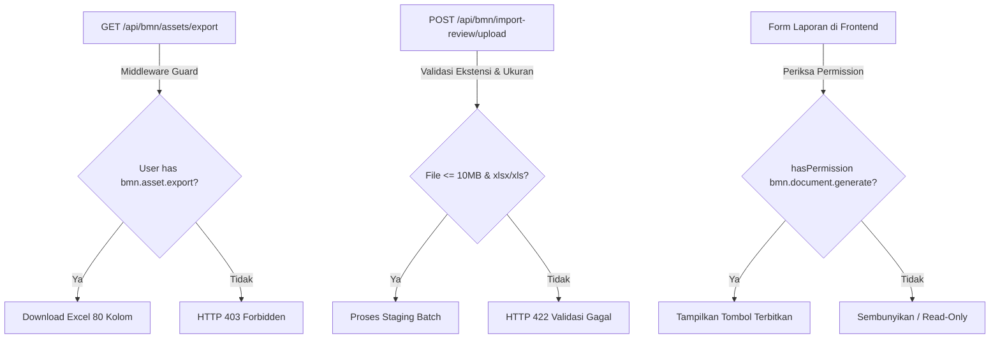

# Desain Arsitektur Teknis (TDD): Modernisasi UI/UX & Pengerasan Keamanan BMN (Full Internals)

> **Acuan visual terbaru (10 November 2026):** baca [Panduan Visual Modul BMN](visual-guidelines.md) untuk warna, border, hover dan kecepatan animasi. Cuplikan kelas visual di dokumen ini adalah snapshot lama; cakupan penerapan terbaru dicatat di panduan tersebut dan progress, bukan disimpulkan dari status historis di bawah.

> **Arsitektur**: Next.js App Router (TypeScript) + Tailwind CSS + Lucide React + TanStack Query v5 + Laravel Sanctum  
> **Pendekatan**: Ponytail Minimal Diff, zero boilerplate baru, reuse pola Kepegawaian  
> **Status**: Deep Internals Hardened (Mencakup Seluruh Sub-halaman BMN)

---

## 1. Arsitektur Navigasi & Layout Induk (`bmn/layout.tsx`)

### 1.1 Struktur Menu & Skema Pengelompokan
Menggantikan array datar 10 item dengan struktur hierarkis bertipe kuat:

```typescript
type BmnSidebarGroup = 
  | "Ringkasan" 
  | "Inventaris & Transaksi" 
  | "Penghapusan & Lelang" 
  | "Dokumen & Pengaturan";

type BmnSidebarItem = {
  href: string;
  label: string;
  icon: React.ComponentType<{ className?: string }>;
  permission: string;
  group: BmnSidebarGroup;
};

const BMN_SIDEBAR_ITEMS: BmnSidebarItem[] = [
  // 1. Ringkasan
  { href: "/bmn", label: "Dashboard", icon: LayoutDashboard, permission: "bmn.view", group: "Ringkasan" },
  
  // 2. Inventaris & Transaksi
  { href: "/bmn/assets", label: "Data Aset", icon: Package, permission: "bmn.view", group: "Inventaris & Transaksi" },
  { href: "/bmn/loans", label: "Peminjaman", icon: Handshake, permission: "bmn.view", group: "Inventaris & Transaksi" },
  { href: "/bmn/maintenances", label: "Pemeliharaan", icon: Wrench, permission: "bmn.view", group: "Inventaris & Transaksi" },
  { href: "/bmn/import-review", label: "Import Review", icon: FileUp, permission: "bmn.import.review", group: "Inventaris & Transaksi" },
  
  // 3. Penghapusan & Lelang
  { href: "/bmn/auction-candidates", label: "Kandidat Rusak Berat", icon: Gavel, permission: "bmn.auction.view", group: "Penghapusan & Lelang" },
  { href: "/bmn/auction-batches", label: "Paket Lelang BMN", icon: Layers, permission: "bmn.auction.view", group: "Penghapusan & Lelang" },
  { href: "/bmn/disposal", label: "Aset Dihapus", icon: Trash2, permission: "bmn.asset.dispose", group: "Penghapusan & Lelang" },
  
  // 4. Dokumen & Pengaturan
  { href: "/bmn/reports", label: "Dokumen & Laporan", icon: FileText, permission: "bmn.document.history.view", group: "Dokumen & Pengaturan" },
  { href: "/bmn/settings", label: "Pengaturan Master", icon: Settings, permission: "bmn.view", group: "Dokumen & Pengaturan" },
];
```

### 1.2 Transisi Lebar Sidebar (Desktop Rail Mode)
* **Expanded**: `md:w-72` — Menampilkan nama grup (huruf kapital 10px tracking-widest), teks label lengkap, pemilih modul `ModuleSwitcher`, dan footer info user.
* **Collapsed**: `md:w-20` — Hanya menampilkan ikon terpusat (`justify-center p-2.5`), nama grup disembunyikan, dan atribut native `title={item.label}` aktif untuk tooltip tanpa dependensi library eksternal.
* **Active Indicator**: Garis vertikal tebal 4px di sisi kiri:
  ```tsx
  {isActive && (
    <span className="absolute left-0 top-2 bottom-2 w-1 rounded-r bg-emerald-600 dark:bg-emerald-400" />
  )}
  ```

### 1.3 Navigasi Mobile Bebas Tabrakan
Menghapus tombol mengambang `fixed bottom-6 right-6 p-4 rounded-full` yang menghalangi kontrol tabel. Menggantinya dengan:
* Header bar mobile bersih di bagian atas dengan tombol hamburger trigger.
* Backdrop penutup layar gelap `bg-slate-950/60 backdrop-blur-xs` saat laci mobile terbuka.

---

## 2. Blueprint Teknis Sub-Halaman Internal ("Jeroan" BMN)

### 2.1 Wizard Tambah Aset (`assets/create/page.tsx`)
* **Dukungan Dark Mode Total**:
  * Kontainer wizard: `bg-white dark:bg-zinc-900 ring-1 ring-slate-200/60 dark:ring-zinc-800 text-slate-900 dark:text-zinc-100`.
  * Input & Select fields: `bg-white dark:bg-zinc-800/80 border-slate-200 dark:border-zinc-700 text-slate-900 dark:text-zinc-100 focus:ring-emerald-500`.
* **Stepper Responsif**:
  * Pada layar `< 640px`, sembunyikan teks label step, hanya tampilkan badge nomor step (`1/5`) dengan indikator progress bar horizontal, atau scroll horizontal berpenanda.
* **Tata Letak Grid Responsif**:
  * Ubah seluruh `grid grid-cols-2 gap-4` menjadi `grid grid-cols-1 sm:grid-cols-2 gap-4` agar field input tidak menyempit di bawah 160px pada layar ponsel.

### 2.2 Formulir Peminjaman Baru (`loans/create/page.tsx`)
* **Filter Aset Tersedia**:
  * Saat mencari aset via combobox, beri label visual dan non-aktifkan aset yang berstatus `active_loan` atau `Rusak Berat`.
* **Penyajian Pesan Error Backend**:
  * Ubah error handler agar tidak menelan pesan:
    ```typescript
    toast.error(error.response?.data?.message || "Gagal mengirim permohonan");
    ```

### 2.3 Review Import Batch (`import-review/[batchId]/page.tsx`)
* **Summary Cards Responsif**:
  * Ubah `grid grid-cols-4 gap-4` menjadi `grid grid-cols-2 md:grid-cols-4 gap-3 md:gap-4`.
* **Dukungan Dark Mode**:
  * Tambahkan kelas dark mode pada filter identitas: `bg-white dark:bg-zinc-900 border border-slate-200 dark:border-zinc-800`.
  * Input pencarian: `bg-slate-50 dark:bg-zinc-800 border-slate-200 dark:border-zinc-700 text-slate-900 dark:text-zinc-100`.
* **Stacked Diff Cards**:
  * Pada viewport `< md`, baris perbandingan diff lama vs baru diubah menjadi kartu tumpuk vertikal berbingkai halus dengan status badge (*Merah = Nilai Lama, Hijau = Usulan Nilai Baru*).

### 2.4 Detail Aset Cockpit & Pembersihan Polling (`assets/[id]/page.tsx`)
* **Hapus Polling 3 Detik**:
  * Hapus baris `refetchInterval: 3000`. Refetch data reaktif via `queryClient.invalidateQueries`.
* **Breadcrumb Mobile (< 640px)**:
  * Teks panjang dipotong menjadi: Tombol Kembali + `KD: {kode_barang} • NUP {nup}`.
* **Sticky Bottom Action Bar**:
  * Pada mode edit di mobile, tombol aksi "Simpan Perubahan" dan "Batal" dipasang di *bottom sticky bar* (`sticky bottom-0 z-40 bg-white/95 dark:bg-zinc-900/95 backdrop-blur-md p-3`).

### 2.5 Halaman Lelang 10 Tab (`auction-batches/[id]/page.tsx`)
* **Mobile Dropdown Switcher**:
  * Pada viewport mobile `< md` (768px), 10 tab horizontal yang meluap digantikan oleh dropdown pemilih seksi (`<select value={activeTab}>`).
* **Stacked Valuation Cards**:
  * Tabel harga taksiran lelang pada `ValuationTab` diubah menjadi kartu per aset di layar ponsel dengan input rupiah setinggi 44px.

---

## 3. Matriks Pengerasan Keamanan Backend (Security Hardening)



### 3.1 Penguncian Route Ekspor
* Di [`backend/app/Modules/Bmn/Routes/api.php`](file:///E:/bksda-superapp/backend/app/Modules/Bmn/Routes/api.php):
  ```php
  Route::get('assets/export', [ExportController::class, 'assets'])->middleware('permission:bmn.asset.export');
  Route::get('loans/export', [ExportController::class, 'loans'])->middleware('permission:bmn.asset.export');
  Route::get('maintenances/export', [ExportController::class, 'maintenances'])->middleware('permission:bmn.asset.export');
  ```
  *(Dengan fallback alias jika user memiliki `bmn.asset.update`)*.

### 3.2 Validasi Unggah Berkas
* Di `ImportReviewController::upload`:
  ```php
  $request->validate([
      'file' => ['required', 'file', 'mimes:xlsx,xls', 'max:10240'],
  ]);
  ```

---

## 4. Batas Aman Cetak Dokumen A4 (*Safety Boundary*)

Komponen cetak fisik instansi resmi berikut **DILINDUNGI PENUH DARI PERUBAHAN TATA LETAK**:
* [`AuctionDocumentRenderer.tsx`](file:///E:/bksda-superapp/frontend/src/app/bmn/auction-batches/[id]/_components/AuctionDocumentRenderer.tsx)
* [`CoveringLetterDocument.tsx`](file:///E:/bksda-superapp/frontend/src/app/bmn/reports/_components/CoveringLetterDocument.tsx)
* [`HandoverAgreementDocument.tsx`](file:///E:/bksda-superapp/frontend/src/app/bmn/reports/_components/HandoverAgreementDocument.tsx)
* [`PowerOfAttorneyDocument.tsx`](file:///E:/bksda-superapp/frontend/src/app/bmn/reports/_components/PowerOfAttorneyDocument.tsx)
* [`UsageAgreementDocument.tsx`](file:///E:/bksda-superapp/frontend/src/app/bmn/reports/_components/UsageAgreementDocument.tsx)

---

## 5. Spesifikasi Pengujian Otomatis (*Automated Test Harness*)

Pengujian otomatis mandiri dibangun pada:
[`backend/tests/Feature/BmnLayoutAndSecurityRegressionTest.php`](file:///E:/bksda-superapp/backend/tests/Feature/BmnLayoutAndSecurityRegressionTest.php)

Cakupan Test Method:
1. `test_bmn_export_endpoint_forbids_user_with_only_view_permission` (HTTP 403 vs HTTP 200).
2. `test_bmn_import_upload_rejects_oversized_file_and_invalid_mime` (HTTP 422).
3. `test_bmn_loan_crud_rbac_integrity` (Verifikasi proteksi transaksi peminjaman).
