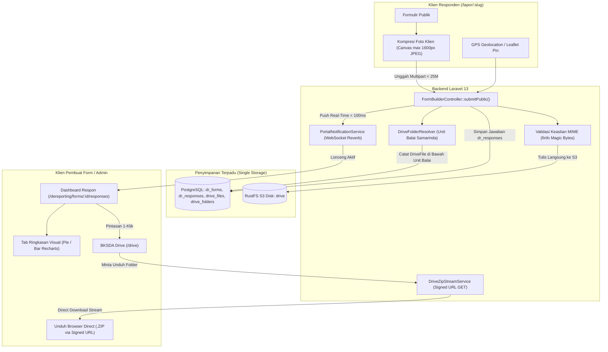

# Desain Arsitektur v2: Peningkatan DeReporting Form Builder & BKSDA Drive

> **Dokumen Terkait**: [requirements.md](file:///e:/bksda-superapp/docs/dereporting-forms-and-drive-enhancements/requirements.md) | [tasks.md](file:///e:/bksda-superapp/docs/dereporting-forms-and-drive-enhancements/tasks.md)
> **Versi**: 2.0 — Arsitektur Teknis Bersih (Efisiensi Tinggi, Bebas Redundansi Disk & Kuota Pribadi)

---

## 1. Arsitektur Alur Sistem (System Architecture)



---

## 2. Perubahan Skema Basis Data (Database Schema)

### 2.1. Tabel `dr_forms`
Migrasi PostgreSQL menggunakan tipe data yang valid (UUID foreign reference dan nullable BigInt):
```php
Schema::table('dr_forms', function (Blueprint $table) {
    $table->foreignId('drive_folder_id')
        ->nullable()
        ->constrained('drive_folders')
        ->nullOnDelete();
    $table->timestamp('closed_at')->nullable();
    $table->text('closed_message')->nullable();
});
```

### 2.2. Format Komposit Kunci Unik di `drive_files`
Tabel `drive_files` memiliki indeks `UNIQUE(source_module, source_id)`.
Agar satu tanggapan form dengan multiple berkas tidak bertabrakan (*key collision*), `source_id` diformat sebagai komposit:
```php
$sourceId = "{$response->id}:{$fieldId}:{$fileIndex}";
// Contoh: "9d7a2f1b-3c4e-4f5a-8b9c-1d2e3f4a5b6c:foto_satwa:0"
```

### 2.3. Struktur JSON Field Skema (`fields`)
Mendukung `file` (multi-file 1 s.d. 5) dan `gps_location`:
```json
[
  {
    "id": "foto_temuan",
    "type": "file",
    "label": "Dokumentasi Foto Satwa / Patroli",
    "required": true,
    "max_files": 5,
    "allowed_types": ["image/*", "application/pdf"],
    "max_size_mb": 10
  },
  {
    "id": "koordinat_lokasi",
    "type": "gps_location",
    "label": "Titik Koordinat Lokasi Temuan",
    "required": true
  }
]
```

### 2.4. Struktur JSON Jawaban (`dr_responses`)
- `file_paths`:
  ```json
  {
    "foto_temuan": [
      "users/balai-samarinda/dereporting/form-slug/uuid1.jpg",
      "users/balai-samarinda/dereporting/form-slug/uuid2.jpg"
    ]
  }
  ```
- `answers`:
  ```json
  {
    "koordinat_lokasi": {
      "latitude": -0.502106,
      "longitude": 117.153709,
      "accuracy": 8.4,
      "address_hint": "Taman Hutan Raya Bukit Soeharto"
    }
  }
  ```

---

## 3. Desain Komponen Inti & Kebijakan Hak Akses

### 3.1. Pengalokasian Folder & Kuota di BKSDA Drive
- **Unit Kerja Balai**: Folder form dibuat di bawah unit kerja `balai-samarinda` (kuota 100 GB).
- **Hierarki**:
  `Drive Bersama > Balai BKSDA Samarinda > Formulir DeReporting > [Judul Formulir] (Tanggapan)`
- **Bebas Kuota Pribadi Pegawai**: Kolom `user_id` pada `DriveFile` diisi `super_admin_id` dan `unit_id` diisi ID unit `balai-samarinda`. Dengan demikian, formula kuota pribadi pegawai:
  `DriveFile::where('user_id', $pegawai->id)->whereNull('unit_id')->sum('size_bytes')`
  tetap bernilai **0 byte**. Kuota 5 GB milik pembuat form tidak tersedot.

### 3.2. Resolusi Otorisasi Pembuat Form di `DriveAccess.php`
Agar pembuat form selalu berhak mengelola, melihat, mengunduh, dan membagikan folder dan berkas form miliknya tanpa dependensi tabel per-file:
```php
// app/Support/Security/DriveAccess.php
public static function canWriteFile(User $user, DriveFile $file): bool
{
    if ($user->role === 'super_admin') return true;

    // Cek keterkaitan dengan form DeReporting milik user
    if ($file->source_module === 'dereporting' && $file->source_id) {
        $parts = explode(':', $file->source_id);
        $responseId = $parts[0] ?? null;
        if ($responseId) {
            $resp = DynamicFormResponse::with('form')->find($responseId);
            if ($resp && (string)$resp->form?->created_by === (string)$user->id) {
                return true;
            }
        }
    }

    if ($file->unit_id) {
        $unit = $file->unit ?? DriveUnit::find($file->unit_id);
        return $unit ? self::canWrite($user, $unit) : false;
    }

    return $file->user_id === $user->id;
}
```

### 3.3. Unduh Folder ZIP Cepat & Hemat Memori (`ZipStream-PHP`)
- **Alur Kerja**:
  1. Frontend meminta URL unduhan: `POST /api/drive/folders/{id}/zip-token`.
  2. Backend memvalidasi hak akses dan mengembalikan signed URL:
     `URL::temporarySignedRoute('drive.folder.zip', now()->addMinutes(15), ['id' => $folder->id])`.
  3. Frontend memicu browser native download via `window.location.href = signedUrl`.
  4. Controller membuka output stream dengan `ZipStream-PHP`, mengambil stream berkas dari RustFS S3, dan membersihkan nama berkas dari path traversal:
     `$safePath = preg_replace('/(\.\.[\/\\\\])+/', '', $file->name);`
  5. **Hasil**: Memori browser 0 byte (langsung ke disk unduhan OS), memori RAM server $\le$ 10 MB konstan.

### 3.4. Notifikasi Real-Time Murni (Tanpa Kuota Email)
Saat responden berhasil mengirim formulir publik:
```php
// Backend tidak mengirim email transaksional per tanggapan!
// Cukup trigger WebSocket instan ke pembuat form:
if ($form->created_by) {
    PortalNotificationService::notify(
        userId: $form->created_by,
        title: "Tanggapan Baru Diterima",
        message: "Laporan baru masuk pada formulir '{$form->title}'.",
        actionUrl: "/dereporting/forms/{$form->id}/responses",
        module: "dereporting"
    );
}
```

---

## 4. Rincian API Endpoint Baru

| Metode | Endpoint | Hak Akses | Keterangan |
|---|---|---|---|
| `GET` | `/api/dereporting/forms/{id}/summary` | Pembuat / Admin | Mengambil data statistik diagram respon |
| `POST` | `/api/drive/folders/{id}/zip-token` | Reader / Editor | Menghasilkan signed URL untuk unduh ZIP |
| `GET` | `/api/drive/folders/{id}/download-zip` | Signed URL Valid | Men-stream arsip ZIP folder ke browser |
| `POST` | `/api/drive/folders/{id}/move` | Editor / Manager | Memindahkan folder ke parent folder baru |
| `POST` | `/api/drive/files/{id}/move` | Editor / Manager | Memindahkan berkas ke folder baru |
