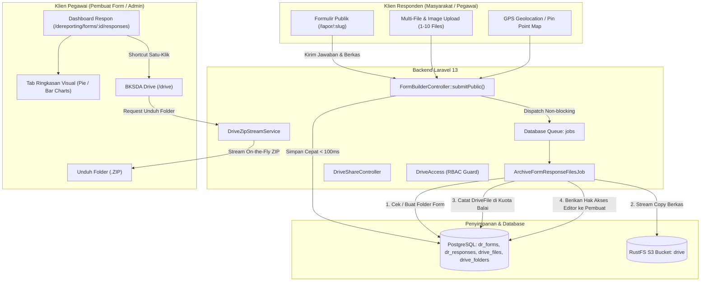

# Desain Arsitektur: Peningkatan DeReporting Form Builder & BKSDA Drive

> **Dokumen Terkait**: [requirements.md](file:///e:/bksda-superapp/docs/dereporting-forms-and-drive-enhancements/requirements.md) | [tasks.md](file:///e:/bksda-superapp/docs/dereporting-forms-and-drive-enhancements/tasks.md)
> **Versi**: 1.0 — Desain Arsitektur Teknis Lengkap

---

## 1. Arsitektur Alur Sistem (System Architecture)



---

## 2. Perubahan Skema Basis Data (Database Schema)

### 2.1. Tabel `dr_forms`
Penambahan kolom pendukung integrasi Drive, notifikasi, dan penjadwalan:
```sql
ALTER TABLE dr_forms
    ADD COLUMN drive_folder_id BIGINT UNSIGNED NULL REFERENCES drive_folders(id) ON DELETE SET NULL,
    ADD COLUMN email_notifications_enabled BOOLEAN NOT NULL DEFAULT FALSE,
    ADD COLUMN closed_at TIMESTAMP NULL,
    ADD COLUMN closed_message TEXT NULL;
```

### 2.2. Struktur JSON Field Skema (`fields`)
Mendukung `file` (multi-file) dan `gps_location`:
```json
[
  {
    "id": "foto_dokumentasi",
    "type": "file",
    "label": "Dokumentasi Foto di Lapangan",
    "required": true,
    "max_files": 5,
    "allowed_types": ["image/*", "application/pdf"],
    "max_size_mb": 10
  },
  {
    "id": "titik_koordinat",
    "type": "gps_location",
    "label": "Lokasi Kejadian / Temuan",
    "required": true
  }
]
```

### 2.3. Struktur Jawaban (`answers` & `file_paths` di `dr_responses`)
- `file_paths`:
  ```json
  {
    "foto_dokumentasi": [
      "private/dereporting/forms/patroli/uuid1.jpg",
      "private/dereporting/forms/patroli/uuid2.jpg"
    ]
  }
  ```
- `answers` untuk GPS:
  ```json
  {
    "titik_koordinat": {
      "latitude": -0.502106,
      "longitude": 117.153709,
      "accuracy": 12.5,
      "address_hint": "Sungai Karang Mumus, Samarinda"
    }
  }
  ```

---

## 3. Desain Komponen Inti

### 3.1. Job Asinkron: `ArchiveFormResponseFilesJob`
- **Tujuan**: Memastikan berkas masuk ke BKSDA Drive tanpa memperlambat pengalaman pengguna di formulir.
- **Hierarki Folder**:
  - Root: `Formulir DeReporting` (dibuat di bawah unit Balai / user SuperAdmin).
  - Subfolder: `[Judul Formulir] (Tanggapan)`.
- **Alokasi Kuota**:
  - `DriveFile.user_id = SuperAdmin` (kuota institusi/balai).
  - `DriveShare`: Secara otomatis menyematkan izin `role = 'editor'` kepada `form->created_by`.
- **Nama Berkas Search-Friendly**:
  `RESP-{id}_{field_label}_{index}_{clean_filename}`

### 3.2. Streaming Download Folder ZIP (`ZipStreamService`)
- Menggunakan standar pustaka streaming ZIP HTTP (`maennchen/zipstream-php` atau stdlib native PHP zip stream output).
- Alur kerja:
  1. Ambil daftar seluruh file di dalam folder (dan subfolder).
  2. Buka `php://output` dengan header `Content-Type: application/zip` dan `Content-Disposition: attachment; filename="[Nama_Folder].zip"`.
  3. Baca stream setiap berkas langsung dari disk S3 RustFS (`Storage::disk('drive')->readStream($s3Key)`) dan masukkan ke dalam zip.
  4. **Keuntungan**: Tidak memerlukan penyimpanan sementara (*zero temp disk space*) dan memori RAM server tetap konstan ($\le$ 10 MB).

### 3.3. Pindahkan Berkas/Folder (*Move To*)
- Endpoint:
  - `POST /api/drive/files/{id}/move` $\rightarrow$ `{ "folder_id": 42 }`
  - `POST /api/drive/folders/{id}/move` $\rightarrow$ `{ "parent_id": 10 }`
- Validasi: Mencegah siklus rekursif (*circular reference* di mana folder dipindahkan ke dalam anaknya sendiri).

### 3.4. Transfer Kepemilikan (*Transfer Ownership*)
- Endpoint: `POST /api/drive/folders/{id}/transfer-ownership`
- Payload: `{ "target_user_id": 1 }`
- Logika Atomik:
  1. Cari seluruh rekursi `folder_id`.
  2. `UPDATE drive_folders SET user_id = :target WHERE id IN (:allIds)`.
  3. `UPDATE drive_files SET user_id = :target WHERE folder_id IN (:allIds)`.
  4. Berikan izin `DriveShare` editor kepada pemilik lama.

### 3.5. Ringkasan Grafik Tanggapan (*Summary Visual Analytics*)
- Endpoint: `GET /api/dereporting/forms/{id}/summary`
- Mengembalikan agregasi data:
  - Pilihan ganda / Select / Radio: Frekuensi tiap opsi (persentase & jumlah).
  - Checkbox: Frekuensi kombinasi pilihan.
  - Tanggal: Distribusi entri per hari/minggu.
  - File: Jumlah berkas terunggah & total ukuran bytes.
- Frontend me-render menggunakan pustaka diagram ringan (misal: Recharts atau native SVG Bar/Pie) dengan tema gelap/terang.

---

## 4. API Endpoint Baru & Pembaruan Kontrak

| Metode | Endpoint | Hak Akses | Keterangan |
|---|---|---|---|
| `GET` | `/api/dereporting/forms/{id}/summary` | Pembuat / Admin | Mengambil agregasi grafik jawaban |
| `POST` | `/api/drive/folders/{id}/download-zip` | Reader / Editor | Mengunduh seluruh folder sebagai ZIP |
| `POST` | `/api/drive/folders/{id}/move` | Editor / Manager | Memindahkan folder ke parent baru |
| `POST` | `/api/drive/files/{id}/move` | Editor / Manager | Memindahkan berkas ke folder baru |
| `POST` | `/api/drive/folders/{id}/transfer-ownership` | Owner / SuperAdmin | Menyerahkan kepemilikan folder & berkas |
| `POST` | `/api/drive/files/{id}/transfer-ownership` | Owner / SuperAdmin | Menyerahkan kepemilikan satu berkas |
