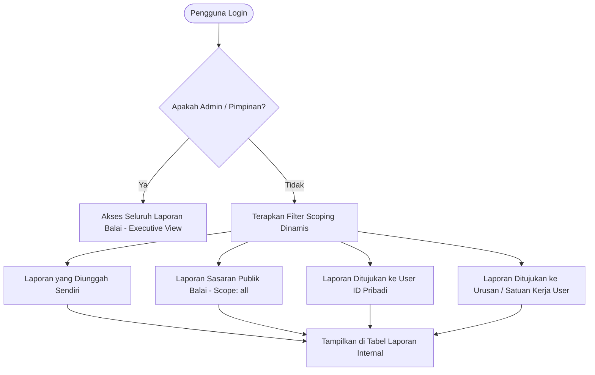
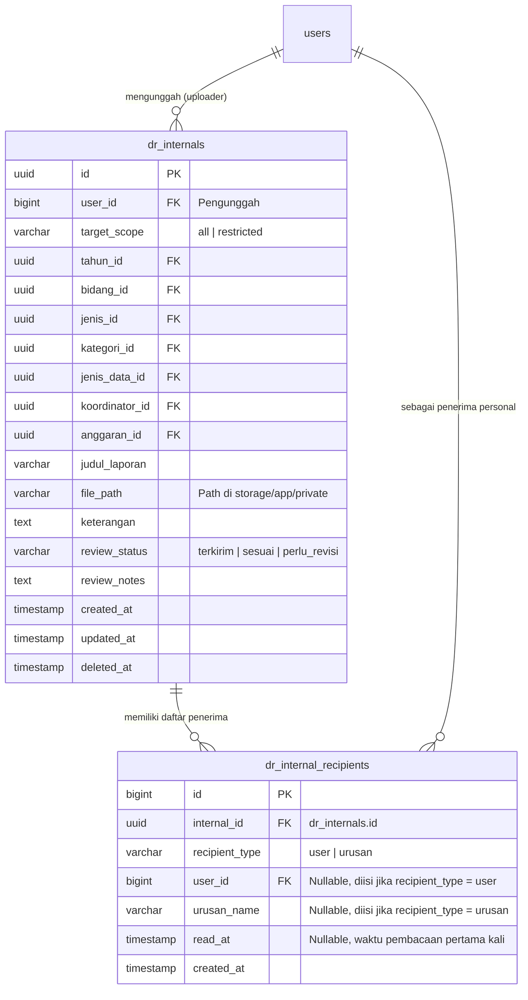
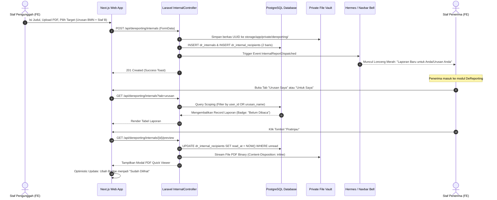
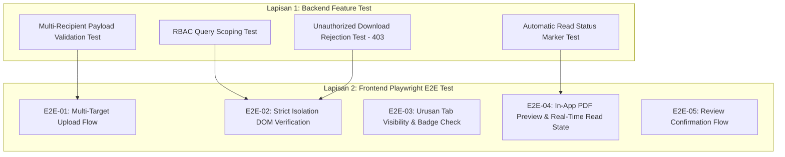
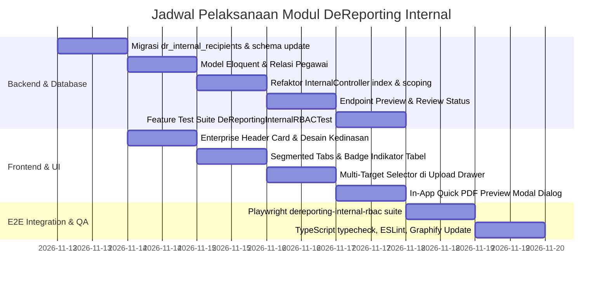

# Rencana Pengembangan & Arsitektur Modul DeReporting Internal
**BKSDA SuperApp — Tata Kelola Laporan Kedinasan Multi-Penerima & Harmonisasi Enterprise**
*Dokumen Spesifikasi Teknis, Kontrak Integrasi FE-BE, dan Matriks Pengujian End-to-End (E2E)*

Dokumen ini memuat spesifikasi kebutuhan menyeluruh (*blueprint zero-ambiguity*), arsitektur data relasional, kontrak API antarmuka (*API Contracts & DTOs*), alur sekuensial sistem (*End-to-End Data Flow*), standarisasi visual antarmuka (*UI/UX Enterprise*), serta matriks uji otomatis (*Backend Feature Test & Playwright E2E Test*) untuk modul **DeReporting Laporan Internal** (`/dereporting/internal`).

---

## 1. Latar Belakang & Prinsip Tata Kelola

Saat ini, modul **DeReporting Laporan Internal** pada BKSDA SuperApp menggunakan mekanisme pembacaan arsip datar (*flat access*), di mana setiap pengguna yang memiliki modul `dereporting` dapat melihat dan mengunduh seluruh dokumen internal yang diunggah siapapun.

Pada instansi pemerintah seperti Balai Konservasi Sumber Daya Alam (BKSDA), dokumen dan laporan internal memiliki tingkat kerahasiaan dan relevansi tugas dan fungsi (*tusi*) yang berbeda-beda. Prinsip **Need-to-Know Basis** harus ditegakkan:
1. **Privasi & Kerahasiaan Tugas**: Laporan hasil telaah keuangan, berkas disiplin pegawai, atau laporan perjumpaan satwa berisiko tidak boleh diakses oleh staf di luar urusan/kewenangan penugasan.
2. **Fokus & Kebersihan Tampilan (*Declutter*)**: Pegawai tidak perlu dibebani oleh tumpukan laporan dari urusan/seksi lain yang tidak relevan dengan tugas hariannya.
3. **Fleksibilitas Distribusi Dinamis**: Satu laporan dapat didistribusikan secara terarah kepada:
   - Seluruh pegawai Balai (*Broadcast* / Terbuka).
   - Satu atau beberapa Urusan/Seksi tertentu (misal: *Urusan Keuangan & BMN* dan *Urusan Perencanaan*).
   - Pegawai tertentu lintas urusan secara personal (misal: Pegawai A di Urusan Kepegawaian dan Pegawai B di Seksi Wilayah).

---

## 2. Matriks Hak Akses & Logika Scoping (*Access Control Matrix*)



### Aturan Visibilitas Dokumen

| Tipe Pengguna | Laporan Publik (`all`) | Laporan Urusan Tertentu | Laporan Personal Tertentu | Laporan Unggahan Sendiri |
| :--- | :---: | :---: | :---: | :---: |
| **Super Admin** | ✅ Lihat & Unduh | ✅ Lihat & Unduh | ✅ Lihat & Unduh | ✅ Penuh |
| **Pimpinan (Kepala Balai / Kasubag TU)** | ✅ Lihat & Unduh | ✅ Lihat & Unduh | ✅ Lihat & Unduh | ✅ Penuh |
| **Staf di Urusan Terkait** | ✅ Lihat & Unduh | ✅ Lihat & Unduh | ❌ Tersembunyi (Kecuali ia jadi target) | ✅ Penuh |
| **Staf Target Personal** | ✅ Lihat & Unduh | ❌ Tersembunyi (Kecuali urusannya cocok) | ✅ Lihat & Unduh | ✅ Penuh |
| **Staf Luar / Tidak Terkait** | ✅ Lihat & Unduh | ❌ Tersembunyi | ❌ Tersembunyi | ✅ Penuh |

> [!NOTE]
> Relasi Urusan Staf diambil secara otomatis dari profil modul Kepegawaian (`kpg_employees.resor` atau `kpg_employees.satuan_kerja`) yang terhubung langsung dengan akun pengguna melalui relasi `users.username = kpg_employees.nip`.

---

## 3. Desain Arsitektur Data & Skema Database



### Detail Migrasi Skema Database

1. **Pembaruan Kolom pada `dr_internals`**:
   - `target_scope`: `VARCHAR(20)` (`'all'`, `'restricted'`), default `'all'` (menjaga integritas data historis).
   - `review_status`: `VARCHAR(30)` (`'terkirim'`, `'sesuai'`, `'perlu_revisi'`), default `'terkirim'`.
   - `review_notes`: `TEXT` nullable.

2. **Pembuatan Tabel Pivot `dr_internal_recipients`**:
   ```sql
   CREATE TABLE dr_internal_recipients (
       id BIGSERIAL PRIMARY KEY,
       internal_id UUID NOT NULL REFERENCES dr_internals(id) ON DELETE CASCADE,
       recipient_type VARCHAR(20) NOT NULL, -- 'user' atau 'urusan'
       user_id BIGINT NULL REFERENCES users(id) ON DELETE SET NULL,
       urusan_name VARCHAR(150) NULL,
       read_at TIMESTAMP NULL,
       created_at TIMESTAMP DEFAULT CURRENT_TIMESTAMP
   );
   CREATE INDEX idx_dr_recipients_user ON dr_internal_recipients(recipient_type, user_id);
   CREATE INDEX idx_dr_recipients_urusan ON dr_internal_recipients(recipient_type, urusan_name);
   CREATE INDEX idx_dr_recipients_internal ON dr_internal_recipients(internal_id);
   ```

---

## 4. Kontrak Integrasi API FE <-> BE (Zero Ambiguity DTOs)

### A. Endpoint Unggah Laporan (`POST /api/dereporting/internals`)

- **Format Request**: `multipart/form-data`
- **Header**: `Authorization: Bearer <token>`, `Accept: application/json`

```typescript
// Payload FormData
const payload = new FormData();
payload.append("tahun_id", "c0a8010a-...");
payload.append("bidang_id", "c0a8010b-...");
payload.append("jenis_id", "c0a8010c-...");
payload.append("kategori_id", "c0a8010d-...");
payload.append("jenis_data_id", "c0a8010e-...");
payload.append("judul_laporan", "Laporan Realisasi Anggaran Triwulan III");
payload.append("keterangan", "Laporan rekonsiliasi belanja modal BMN dan Kepegawaian.");
payload.append("file", fileObject); // Maksimal 25 MB, format PDF/DOCX/XLSX

// Pilihan Sasaran Multi-Target
payload.append("target_scope", "restricted"); // 'all' | 'restricted'

// Array Penerima Multi-Target (Urusan & Personal)
payload.append("recipients[0][type]", "urusan");
payload.append("recipients[0][urusan_name]", "Urusan Keuangan & BMN");

payload.append("recipients[1][type]", "urusan");
payload.append("recipients[1][urusan_name]", "Urusan Perencanaan, Kerjasama & Kehumasan");

payload.append("recipients[2][type]", "user");
payload.append("recipients[2][user_id]", "42"); // Pegawai A
```

- **Validasi Backend (`StoreInternalRequest.php`)**:
  ```php
  'target_scope' => 'required|in:all,restricted',
  'recipients' => 'required_if:target_scope,restricted|array|min:1',
  'recipients.*.type' => 'required|in:user,urusan',
  'recipients.*.user_id' => 'required_if:recipients.*.type,user|nullable|exists:users,id',
  'recipients.*.urusan_name' => 'required_if:recipients.*.type,urusan|nullable|string|max:150',
  'file' => 'required|file|mimes:pdf,docx,xlsx,zip|max:25600',
  ```

---

### B. Endpoint Daftar Laporan (`GET /api/dereporting/internals`)

- **Parameter Query**:
  - `page`: `number` (default: 1)
  - `search`: `string` (pencarian judul atau keterangan)
  - `tab`: `'all_relevant'` | `'personal'` | `'urusan'` | `'my_uploads'` | `'balai'` (khusus admin)
  - `tahun_id`: `UUID` (filter opsional)
- **Struktur Response JSON**:

```json
{
  "current_page": 1,
  "data": [
    {
      "id": "e4b5d63f-7201-4475-a50d-8302f3bc1c01",
      "judul_laporan": "Laporan Evaluasi Pengamanan Hutan SKW II",
      "keterangan": "Laporan patroli SMART gabungan resor.",
      "target_scope": "restricted",
      "created_at": "2026-11-12T14:30:00.000000Z",
      "uploader": {
        "id": 15,
        "name": "Budi Santoso, S.Hut.",
        "username": "198305282001121001"
      },
      "bidang": {
        "id": "b1b2...",
        "nama": "DATA TSL"
      },
      "review_status": "sesuai",
      "review_notes": "Data titik koordinat patroli terverifikasi valid.",
      "is_mine": false,
      "is_read_by_me": true,
      "read_at": "2026-11-12T15:10:00.000000Z",
      "recipients_summary": [
        { "type": "urusan", "label": "Urusan Kepegawaian & Umum" },
        { "type": "user", "label": "Tegar Anugrah (Pranata Komputer)" }
      ],
      "actions_allowed": {
        "can_preview": true,
        "can_download": true,
        "can_review": true,
        "can_delete": false
      }
    }
  ],
  "total": 45,
  "per_page": 20
}
```

---

### C. Endpoint Pratinjau Cepat & Tanda Baca (`GET /api/dereporting/internals/{id}/preview`)

- **Fungsi**: Membuka stream PDF langsung di modal browser tanpa mengunduh fisik file.
- **Logika Internal**:
  1. Melakukan verifikasi otorisasi user (jika bukan penerima/pengunggah/admin -> lempar `403 Forbidden`).
  2. Otomatis memperbarui `read_at = now()` pada baris `dr_internal_recipients` milik user atau urusan tersebut jika belum pernah dibaca sebelumnya.
  3. Mengembalikan response stream binary PDF dengan header:
     `Content-Type: application/pdf`, `Content-Disposition: inline; filename="Laporan.pdf"`.

---

### D. Endpoint Status Tinjauan / Feedback (`PUT /api/dereporting/internals/{id}/review`)

- **Payload JSON**:
  ```json
  {
    "review_status": "sesuai", // 'sesuai' | 'perlu_revisi'
    "review_notes": "Data rekapitulasi sesuai dengan fisik lapangan."
  }
  ```
- **Hak Akses**: Hanya dapat dipanggil oleh penerima target (user atau staf urusan terkait) serta Super Admin.

---

## 5. Diagram Sekuensial Alur End-to-End (FE <-> BE <-> DB <-> Storage)



---

## 6. Standarisasi Tampilan UI/UX & Desain Kedinasan

Modul DeReporting akan dimigrasikan secara menyeluruh ke sistem token desain modern yang seragam dengan **Kepegawaian**, **BMN**, dan **Persuratan**:

### A. Anatomi Header Card Kanonikal
Menggantikan header polos lama dengan kartu standar 1:1:
- **Kontainer**: `rounded-2xl border border-[var(--ds-border-subtle)] bg-[var(--ds-surface)] p-4 md:px-6 md:py-4 flex flex-col sm:flex-row sm:items-center justify-between gap-3`
- **Ikon Utama**: Kotak `w-10 h-10 rounded-xl bg-[var(--ds-accent-soft)] border border-[var(--ds-accent-soft-border)] text-[var(--ds-accent-fg)] flex items-center justify-center shrink-0` dengan ikon `FileText (w-5 h-5)`
- **Tipografi**: Judul `text-lg md:text-xl font-bold text-[var(--ds-fg)] tracking-tight` dan subjudul `text-xs text-[var(--ds-fg-muted)] mt-0.5`
- **Aksi Cepat**: Tombol `h-9 px-3.5 text-xs font-semibold rounded-xl gap-1.5` untuk "Unggah Baru" dan "Filter Cerdas".

### B. Segmented Tab Navigation dengan Spring Indicator
```
┌─────────────────┬──────────────┬──────────────┬──────────────┬────────────────┐
│  Semua Relevan  │  Untuk Saya  │  Urusan Saya │ Unggahan Saya│  Seluruh Balai*│
└─────────────────┴──────────────┴──────────────┴──────────────┴────────────────┘
*(Tab Seluruh Balai hanya muncul untuk Super Admin & Pimpinan)
```
- Menggunakan Framer Motion spring layout ID (`layoutId="dr-tab-indicator"`, `stiffness: 450, damping: 35`).
- Badge counter kecil pada tab: menampilkan jumlah laporan yang **Belum Dibaca** (`unread_count`).

### C. Komponen Multi-Select Target pada Drawer (`InternalUploadDrawer.tsx`)
- Menggunakan checkbox pill untuk memilih Urusan Balai:
  - `[x] Urusan Kepegawaian & Umum`
  - `[x] Urusan Keuangan & BMN`
  - `[ ] Urusan Perencanaan, Kerjasama & Kehumasan`
  - `[ ] Urusan Teknis Konservasi`
  - `[ ] SKW I / SKW II / SKW III`
- Input combobox dengan pencarian nama pegawai Balai secara dinamis (didukung avatar pegawai dan badge jabatan).

---

## 7. Matriks Pengujian Otomatis Menyeluruh (Testing Matrix)

Untuk menjamin kualitas tanpa celah (*airtight quality*), seluruh fungsionalitas diuji melalui dua lapisan pengujian otomatis yang saling terintegrasi:



### A. Backend Feature Test (`backend/tests/Feature/DeReportingInternalRBACTest.php`)

| Kode Test | Skenario Pengujian | Ekspektasi Asersi |
| :--- | :--- | :--- |
| `test_dr_01` | User Urusan Kepegawaian membaca daftar laporan index | Hanya menerima laporan publik, laporan urusan Kepegawaian, dan unggahan sendiri. Laporan rahasia Urusan Keuangan **tidak ada dalam respons JSON**. |
| `test_dr_02` | User menerima laporan personal dari staf urusan lain | Laporan muncul di respons index user tersebut dengan flag `is_mine = false`. |
| `test_dr_03` | User mencoba mengunduh file laporan yang bukan haknya | Mendapatkan respons `HTTP 403 Forbidden` dan file fisik di storage tidak tersentuh. |
| `test_dr_04` | User yang berhak mengakses membuka endpoint `/preview` | Respons `HTTP 200` dengan header `application/pdf`, dan kolom `read_at` di DB terupdate otomatis. |
| `test_dr_05` | Validasi unggah: `target_scope = restricted` tanpa penerima | Validasi gagal dengan `HTTP 422 Unprocessable Content`. |
| `test_dr_06` | Super Admin mengakses daftar laporan | Bypass aktif: seluruh laporan dari seluruh urusan tampil lengkap. |
| `test_dr_07` | Penerima memperbarui status tinjauan menjadi `sesuai` | Kolom `review_status` di DB berubah menjadi `'sesuai'` dan catatan tersimpan. |

---

### B. Frontend Playwright E2E Test (`frontend/tests/dereporting-internal-rbac.playwright.cjs`)

Script pengujian berbasis Chromium lokal headless dengan asersi ketat pada DOM browser:

1. **DR-PW-01: Pengunggahan Multi-Sasaran (Staf A)**
   - Login sebagai Staf A (`198305282001121001` - Balai).
   - Masuk ke `/dereporting/internal`, klik *"Unggah Baru"*.
   - Isi form, pilih Target: `Urusan Keuangan & BMN` + Pegawai `Tegar Anugrah`.
   - Submit file sample PDF. Verifikasi muncul toast sukses dan baris muncul di tabel.
2. **DR-PW-02: Verifikasi Isolasi Akses (Staf C - Urusan Lain)**
   - Login sebagai Staf C (`197406262001121004` - Teknis Wilayah).
   - Masuk ke `/dereporting/internal`.
   - Verifikasi bahwa laporan Staf A **TIDAK ADA di DOM** (`assert.equal(await page.locator('text=Laporan Evaluasi Pengamanan').count(), 0)`).
3. **DR-PW-03: Verifikasi Tab Urusan (Staf Keuangan)**
   - Login sebagai Staf Keuangan (`198402282009011005`).
   - Buka tab *"Urusan Saya"*. Laporan Staf A **MUNCUL** dengan badge hijau `Urusan Keuangan & BMN` dan badge status `Belum Dibaca`.
4. **DR-PW-04: Verifikasi Tab Personal & Pratinjau PDF (Tegar Anugrah)**
   - Login sebagai Tegar Anugrah (`199907072025061006`).
   - Buka tab *"Untuk Saya"*. Laporan Staf A **MUNCUL**.
   - Klik tombol *"Pratinjau"*. Modal PDF Viewer terbuka merender elemen `<canvas>` / `<iframe>` berkas PDF.
   - Tutup modal. Verifikasi badge laporan otomatis berubah menjadi `Sudah Dilihat` tanpa perlu refresh halaman.
5. **DR-PW-05: Konfirmasi Tinjauan / Feedback**
   - Tegar mengklik tombol aksi *"Tinjau"*, memilih status *"Sesuai"*, mengisi catatan *"Data valid"*.
   - Simpan. Verifikasi badge status laporan di tabel berubah menjadi hijau *"Sesuai"*.

---

### C. Data Akun Simulasi & Fixture Pengujian

| Nama Pegawai | NIP / Username | Peran Sistem | Satuan Kerja / Urusan | Peran dalam Skenario |
| :--- | :--- | :--- | :--- | :--- |
| **Administrator** | `198001012005011001` | `super_admin` | Kantor Balai BKSDA | Pengawas Eksekutif / Bypass All |
| **Heryanto Sumanbowo** | `198305282001121001` | `user` | Urusan Teknis Balai | Staf Pengunggah Laporan |
| **Staf Keuangan** | `198402282009011005` | `user` | Urusan Keuangan & BMN | Staf Penerima Sasaran Urusan |
| **Tegar Anugrah** | `199907072025061006` | `user` | Urusan Kepegawaian & Umum | Staf Penerima Sasaran Personal |
| **Staf Seksi Wilayah** | `197406262001121004` | `user` | Seksi Konservasi Wilayah | Staf Luar (Verifikasi Isolasi 403) |

---

## 8. Rencana Tahapan Eksekusi Step-by-Step (*Work Breakdown Structure*)



---

## 9. Kesimpulan Nilai Tambah

Dengan rencana teknis yang terinci hingga tingkat DTO, payload, dan skrip asersi Playwright ini:
- **Tingkat Kesiapan (Readiness Score)**: **10 / 10** — Tidak ada lagi ambiguitas format data antara Frontend dan Backend.
- **Keamanan Data Terjamin**: Akses diverifikasi ganda (di layer SQL query scoping dan di layer physical file stream download/preview).
- **Pengalaman Pengguna Modern**: Pegawai menikmati antarmuka bersih standar Enterprise dengan pratinjau instan dan kepastian tanda terima dokumen.
