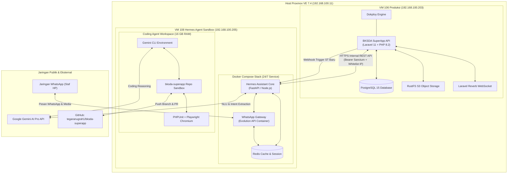
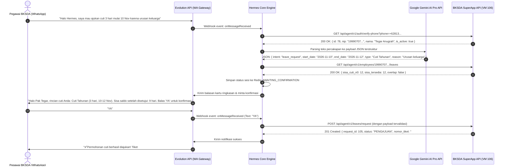
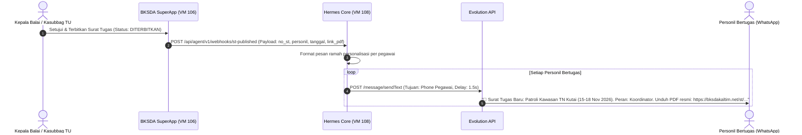

# Technical Architecture & System Design: Hermes Agent BKSDA Kaltim

> **Status**: APPROVED  
> **Arsitektur Host**: Proxmox VE 7.4 (`192.168.100.11`)  
> **Node Target**: VM 108 (`192.168.100.205`), 16 GB RAM, 4 vCPU, 100 GB NVMe  
> **Dokumen Terkait**: [requirements.md](requirements.md) | [tasks.md](tasks.md)

---

## 1. Arsitektur Topologi Jaringan & Komponen



---

## 2. Struktur Modul di VM 108

Di dalam VM 108 (`/opt/hermes/`), sistem dibagi menjadi dua area kerja yang terisolasi rapi:

```text
/opt/hermes/
├── docker-compose.yml          # Stack WhatsApp Gateway & Redis
├── .env                        # Konfigurasi token, API Key Gemini, SuperApp URL
├── assistant/                  # Service Asisten WhatsApp 24/7
│   ├── src/
│   │   ├── gateway/            # Komunikasi ke Evolution API (send/receive chat)
│   │   ├── nlu/                # Integrasi Gemini Pro untuk intent parser
│   │   ├── conversation/       # State machine percakapan (cuti, cek saldo, buat ST)
│   │   ├── superapp_client/    # REST API client ke BKSDA SuperApp
│   │   └── handlers/           # Webhook handler (notifikasi ST terbit dari SuperApp)
│   └── package.json
└── coding-sandbox/             # Workspace Autonomous Coding Agent
    ├── gemini-agent/           # Skrip otomatisasi Gemini CLI
    └── workspace/              # Direktori clone bksda-superapp
```

---

## 3. Desain Alur Percakapan (Sequence Diagrams)

### 3.1. Alur Pengajuan Cuti Mandiri via WhatsApp



---

### 3.2. Alur Siaran Notifikasi Surat Tugas Baru Terbit



---

## 4. Desain Spesifikasi API SuperApp (`/api/agent/v1/*`)

Di `backend/app/Modules/Agent/`, kita menambahkan router khusus agen yang diproteksi dengan:
1. `middleware('auth:sanctum')` dengan token bertipe `agent_token`.
2. `middleware('client_ip:192.168.100.205')` (hanya IP lokal VM 108 yang diizinkan).

### 4.1. Verifikasi Nomor Telepon Pegawai
- **Endpoint**: `POST /api/agent/v1/auth/verify-phone`
- **Request**:
  ```json
  { "phone": "+6281351458775" }
  ```
- **Response (200 OK)**:
  ```json
  {
    "status": "success",
    "data": {
      "id": 78,
      "nip": "199907072025061006",
      "nama_lengkap": "TEGAR ANUGRAH, A.Md.Kom.",
      "jabatan": "PRANATA KOMPUTER TERAMPIL",
      "satuan_kerja": "Balai KSDA Kalimantan Timur",
      "role": "pegawai"
    }
  }
  ```

### 4.2. Pengajuan Cuti via Agen
- **Endpoint**: `POST /api/agent/v1/leaves/request`
- **Request**:
  ```json
  {
    "nip": "199907072025061006",
    "jenis_cuti": "Cuti Tahunan",
    "tanggal_mulai": "2026-11-10",
    "tanggal_selesai": "2026-11-12",
    "alasan_cuti": "Urusan keluarga di Balikpapan",
    "alamat_cuti": "Balikpapan",
    "telepon": "+6281351458775"
  }
  ```
- **Response (201 Created)**:
  ```json
  {
    "status": "success",
    "message": "Pengajuan cuti berhasil dibuat melalui asisten WhatsApp.",
    "data": {
      "id": 105,
      "nomor_tiket": "CT-2026-105",
      "status": "PENGAJUAN",
      "jumlah_hari": 3
    }
  }
  ```

---

## 5. Desain Coding Agent Sandbox & Otomasi CI/CD

### 5.1. Spesifikasi Sandbox di VM 108
- **Direktori**: `/opt/hermes/coding-sandbox/workspace/bksda-superapp`
- **Kapasitas Eksekusi**:
  - Alokasi RAM: 13 GB didedikasikan untuk kompilasi dan testing.
  - Skrip pengawas: Membatasi proses compile agar tidak menyentuh swap (`NODE_OPTIONS="--max-old-space-size=6144"`).

### 5.2. Pipeline Otomatisasi Git Pull Request
Setiap kali Coding Agent diperintahkan menyelesaikan task, agen wajib mengeksekusi urutan pipeline berikut secara berantai:

```bash
# 1. Pastikan repo up to date dari origin
git checkout development
git pull origin development

# 2. Buat branch tugas baru
git checkout -b task/nama-tugas-baru

# 3. Coding Agent menerapkan perubahan file (via Gemini CLI & Gemini Pro)
# ... file editing ...

# 4. Mandatory Runnable Checks
cd backend && php artisan test
cd ../frontend && npm run build

# 5. Jika kedua tes hijau (exit code 0), lakukan push & PR
git add .
git commit -m "feat(module): implementasi task sesuai instruksi"
git push origin task/nama-tugas-baru
gh pr create --title "feat: implementasi task" --body "Rangkuman perubahan..." --base development
```

---

## 6. Konfigurasi Docker Compose di VM 108

```yaml
version: '3.8'

services:
  evolution-api:
    image: atendai/evolution-api:v2.1.2
    container_name: hermes-wa-gateway
    restart: always
    ports:
      - "8080:8080"
    environment:
      - SERVER_URL=http://192.168.100.205:8080
      - DOCKER_ENV=true
      - LOG_LEVEL=ERROR,WARN,INFO
      - AUTHENTICATION_API_KEY=${EVOLUTION_API_KEY}
      - CACHE_REDIS_ENABLED=true
      - CACHE_REDIS_URI=redis://redis:6379/1
    volumes:
      - evo_instances:/evolution/instances
    networks:
      - hermes-net
    depends_on:
      - redis

  redis:
    image: redis:7.2-alpine
    container_name: hermes-redis
    restart: always
    volumes:
      - redis_data:/data
    networks:
      - hermes-net

  hermes-assistant:
    build: ./assistant
    container_name: hermes-assistant-core
    restart: always
    environment:
      - GEMINI_API_KEY=${GEMINI_API_KEY}
      - SUPERAPP_API_URL=http://192.168.100.203
      - SUPERAPP_AGENT_TOKEN=${SUPERAPP_AGENT_TOKEN}
      - EVOLUTION_API_URL=http://evolution-api:8080
      - EVOLUTION_API_KEY=${EVOLUTION_API_KEY}
    networks:
      - hermes-net
    depends_on:
      - evolution-api
      - redis

networks:
  hermes-net:
    driver: bridge

volumes:
  evo_instances:
  redis_data:
```
