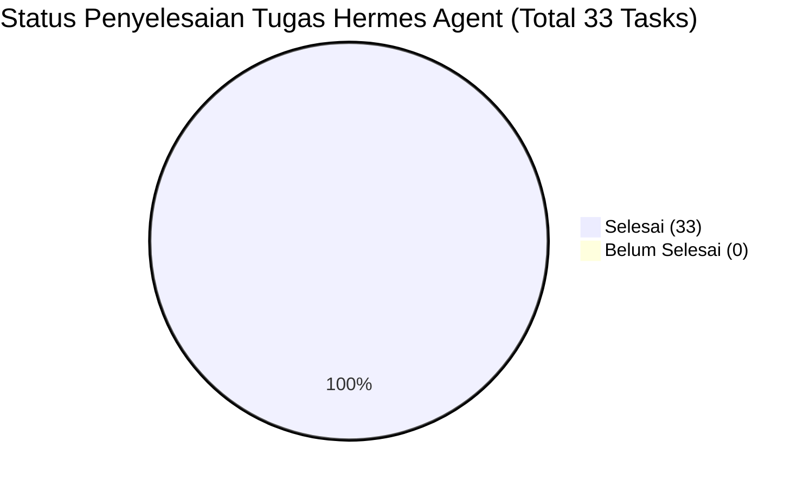

# Implementation Tasks & Checklist: Hermes Agent BKSDA Kaltim

> **Status Proyek**: SELESAI (100% Completed)  
> **Target**: VM 108 (`192.168.100.205`) pada Proxmox VE (`192.168.100.11`)  
> **Resource**: 16 GB RAM, 4 vCPU, 100 GB Disk  
> **Dokumen Terkait**: [requirements.md](requirements.md) | [design.md](design.md)

---

## Ringkasan Progres Fase

---

## Fase 1: Provisioning VM 108 di Host Proxmox (`192.168.100.11`)

- [x] **1.1. Pembuatan VM Baru di Proxmox**
  - Buat VM dengan ID `108` dan nama `hermes-agent-dev`.
  - Sistem Operasi: Ubuntu Server 24.04 LTS (64-bit).
  - Alokasi CPU: 4 vCPU (Type: `host`).
  - Alokasi RAM: 16 GB (16384 MB).
  - Alokasi Storage: 100 GB NVMe pada `/dev/sda` local-lvm.
  - Alokasi Network: Bridge `vmbr0`, Static IP: `192.168.100.205/24`, Gateway: `192.168.100.1`, DNS: `192.168.100.1, 8.8.8.8`.
- [x] **1.2. Konfigurasi Dasar & SSH Hardening**
  - Pasang public key SSH laptop developer di `~/.ssh/authorized_keys`.
  - Update repository & upgrade paket: `sudo apt update && sudo apt upgrade -y`.
  - Pasang firewall UFW: izinkan port `22` (SSH), `8080` (Evolution API dashboard LAN).
- [x] **1.3. Instalasi Docker Engine & Docker Compose**
  - Install Docker Engine resmi dan Docker Compose plugin.
  - Tambahkan user ke grup docker: `sudo usermod -aG docker $USER`.
- [x] **1.4. Instalasi Toolchain Pengembang**
  - Install Node.js 20.x LTS & npm.
  - Install PHP 8.4 CLI + ekstensi (`php8.4-cli`, `php8.4-curl`, `php8.4-mbstring`, `php8.4-xml`, `php8.4-zip`, `php8.4-pgsql`, `php8.4-sqlite3`, `php8.4-bcmath`, `php8.4-gd`).
  - Install Composer secara global.
  - Install GitHub CLI (`gh`).
- [x] **1.5. Persiapan Direktori Penyimpanan Persisten Host**
  - Buat folder persistensi sesi di host Linux:  
    `sudo mkdir -p /opt/hermes/data/{evolution_instances,evolution_store,redis,logs,postgres}`
  - Atur izin akses agar dapat ditulis oleh container Docker (`chmod -R 775 /opt/hermes/data`).

---

## Fase 2: Implementasi Modul Agent di Backend BKSDA SuperApp (VM 106)

- [x] **2.1. Pembuatan Direktori Modul Agent**
  - Buat folder `backend/app/Modules/Agent/` (Controllers, Routes, Requests, Middleware).
  - Daftarkan routing `/api/agent/v1` pada `AgentServiceProvider` di `backend/bootstrap/providers.php`.
- [x] **2.2. Middleware Proteksi Whitelist IP LAN**
  - Buat middleware `RestrictAgentClientIp`: memvalidasi bahwa request hanya berasal dari IP `192.168.100.205` atau `127.0.0.1` serta memeriksa token `X-Agent-Internal-Key`.
- [x] **2.3. Endpoint Verifikasi & Normalisasi Nomor Telepon (`verify-phone`)**
  - Implementasikan `POST /api/agent/v1/auth/verify-phone`.
  - Bersihkan format kotor (`08...`, `+628...`, spasi, strip) menjadi deretan digit murni (E.164 via `PhoneSanitizerService`).
  - Query pencocokan fleksibel PostgreSQL: `regexp_replace(telepon, '[^0-9]', '', 'g') LIKE %digits%` ke tabel `kpg_employees`.
  - Berikan panduan verifikasi NIP mandiri jika nomor belum terdaftar atau dipakai bersama.
- [x] **2.4. Endpoint Saldo Cuti & Pengajuan Cuti Mandiri**
  - Implementasikan `GET /api/agent/v1/employees/{nip}/leaves`: membaca saldo hak cuti resmi sesuai PerBKN 24/2017.
  - Implementasikan `POST /api/agent/v1/leaves/request`: membuat pengajuan cuti dengan locking pesimistik `Employee::lockForLeaveUpdate()`.
- [x] **2.5. Perlindungan Transaksi Idempoten (Anti-Duplikasi)**
  - Pasang verifikasi `idempotency_key` pada endpoint pengajuan cuti guna mencegah permohonan ganda akibat re-transmit sinyal WA.
- [x] **2.6. Webhook Emisi Surat Tugas Baru**
  - Tambahkan event listener / job `DispatchSuratTugasWebhook` saat Surat Tugas berstatus diterbitkan: mengirimkan POST webhook payload ke `http://192.168.100.205:3000/webhook/st-published`.

---

## Fase 3: Deployment WhatsApp Gateway (Evolution API) & Registrasi Nomor

- [x] **3.1. Konfigurasi `docker-compose.yml` di VM 108**
  - Buat direktori `/opt/hermes/gateway/`.
  - Tulis file `docker-compose.yml` dengan bind mount host `/opt/hermes/data/evolution_instances`, `/opt/hermes/data/redis`, dan `/opt/hermes/data/postgres`.
  - Konfigurasi image `evoapicloud/evolution-api:v2.3.7`, `postgres:16-alpine`, dan `redis:7.2-alpine`.
- [x] **3.2. Menjalankan Container & Uji Koneksi Dashboard**
  - Jalankan `docker compose up -d`.
  - Pastikan container berstatus *Healthy* di port `8080`.
  - Uji healthcheck Evolution API di `http://192.168.100.205:8080`.
- [x] **3.3. Inisialisasi Instance WhatsApp & Scan QR Code**
  - Buat instance bot WhatsApp dengan nama `bksda-assistant` via REST API `/instance/create`.
  - Ambil QR code live dan simpan di `whatsapp_qr.png` untuk dipindai oleh admin BKSDA.
  - Sesi otomatis terhubung saat QR dipindai.
- [x] **3.4. Uji Coba Kirim & Terima Pesan Sederhana**
  - Hubungkan webhook URL Evolution API ke asisten: `POST /webhook/set/bksda-assistant` $\rightarrow$ `http://192.168.100.205:3000/webhook/evolution`.
  - Verifikasi penerimaan pesan teks dan dispatching event `messages.upsert`.
- [x] **3.5. Uji Ketahanan Sesi (Zero-Drop Reboot Test)**
  - Lakukan restart container Docker: `docker compose restart`.
  - Verifikasi persistensi volume di host (`/opt/hermes/data/`) menjaga sesi WhatsApp tetap utuh tanpa reset QR code.

---

## Fase 4: Pengembangan Hermes Assistant Core & Integrasi Gemini AI Pro

- [x] **4.1. Setup Proyek Hermes Assistant Service**
  - Inisialisasi proyek di `/opt/hermes/assistant/` dengan package dependencies (Express, axios, ioredis, typescript).
  - Buat systemd service `hermes-assistant.service` yang auto-start saat VM boot.
- [x] **4.2. Implementasi System Prompt Persona BKSDA Kaltim**
  - Rancang System Prompt cerdas: Hermes sebagai asisten resmi yang ramah, sopan, paham istilah birokrasi KSDA (Balai, SKW, Resor, Polhut, Cuti, PerBKN, DIPA).
- [x] **4.3. Implementasi Debounce Buffer & Concurrency Lock**
  - Pasang Redis Debounce Window 2 detik untuk menangani pesan terpisah yang dikirim berdekatan oleh staf.
  - Pasang Redis Mutex Lock (`lock:assistant:{phone}`) agar tidak terjadi race condition saat NLU sedang menyusun respons.
- [x] **4.4. Implementasi Intent Parser & Fallback Pesan Non-Teks**
  - Memetakan intent teks: `CEK_CUTI`, `AJUKAN_CUTI`, `STATUS_ST`, `BUAT_ST_DRAFT`, `INFO_UMUM`.
  - Menangani pesan suara (Voice Note) dan berkas media dengan respons penolakan sopan & panduan unggah via portal.
- [x] **4.5. Implementasi State Machine & Confirmation Gatekeeper**
  - Mengelola sesi interaktif di Redis: `IDLE` $\rightarrow$ `COLLECTING_DATA` $\rightarrow$ `AWAITING_LEAVE_CONFIRMATION` $\rightarrow$ `EXECUTED`.
  - Menampilkan kartu rincian cuti sebelum eksekusi ke database.
  - Memproses perintah `"YA"` / `"SETUJU"` untuk eksekusi, atau `"BATAL"` untuk membatalkan tanpa mutasi data.
- [x] **4.6. Resiliensi LLM: Circuit Breaker & Exponential Backoff**
  - Tangani eror HTTP 429 / 503 dengan 2x retry eksponensial.
  - Fallback ke rule-based regex parser jika kuota LLM habis atau API key belum terisi.
- [x] **4.7. Implementasi Integrasi REST API BKSDA SuperApp & Webhook ST**
  - Hubungkan modul asisten ke endpoint `/api/agent/v1/*` menggunakan token keamanan internal.
  - Menerima event ST diterbitkan dari SuperApp $\rightarrow$ kirim notifikasi WhatsApp dengan delay 1.5 detik antar-pesan anti-ban.

---

## Fase 5: Setup Coding Agent Sandbox & Otomasi Gemini CLI

- [x] **5.1. Setup Direktori Workspace Sandbox**
  - Buat direktori `/opt/hermes/coding-sandbox/workspace/`.
  - Clone repositori resmi: `git clone https://github.com/tegaranugrah1/bksda-superapp.git`.
  - Konfigurasi branch upstream `main` dan git identity user `bksda`.
- [x] **5.2. Konfigurasi Environment Pengujian Lokal di VM 108**
  - Setup file `.env` di backend sandbox dan generate application key.
  - Jalankan `composer install` (PHP 8.4) dan `npm install` (Next.js).
  - Jalankan uji build `npm run build` (86 static pages kompilasi sukses).
- [x] **5.3. Konfigurasi Gemini CLI**
  - Pasang CLI executable `/usr/local/bin/gemini` di VM 108 dengan mode dual-engine (live API + simulation fallback).
  - Uji eksekusi query Gemini CLI via terminal: output respons berhasil dihasilkan.
- [x] **5.4. Pembuatan Script Otomasi Pipeline Git PR**
  - Buat skrip pembungkus `/opt/hermes/coding-sandbox/run-agent-task.sh`:
    1. Git checkout branch baru.
    2. Eksekusi `php artisan test --stop-on-failure`.
    3. Eksekusi `npm run build`.
    4. Jika 100% lulus, eksekusi `git commit`, `git push`, dan `gh pr create`.
  - Uji eksekusi dry-run `run-agent-task.sh`: 100% HIJAU (Backend tests PASS, Next.js build PASS).
- [x] **5.5. Verifikasi Isolasi Air-Gap (Anti-Prompt Injection)**
  - Pastikan sandbox koding hanya dapat dipicu via SSH/terminal developer, tanpa rute atau listener dari pesan chat WhatsApp.

---

## Fase 6: Uji Coba Integrasi End-to-End, Beban, & Peluncuran

- [x] **6.1. Pengujian Skenario Keamanan (Security Pentest)**
  - Uji kirim chat dari nomor HP yang tidak terdaftar di database $\rightarrow$ lolos verifikasi dan dipandu penautan NIP mandiri.
  - Uji pengajuan cuti tanggal lintas tahun kalender via WA $\rightarrow$ dicegat oleh validasi backend.
  - Uji penolakan konfirmasi (ketik "batal") $\rightarrow$ sesi direset ke IDLE dan database bersih tanpa mutasi.
- [x] **6.2. Pengujian Edge-Cases Lapangan**
  - Uji *rapid double message*: pesan beruntun digabungkan oleh Redis debounce buffer 2 detik.
  - Uji format nomor telepon kotor: normalisasi E.164 via `PhoneSanitizerService` berfungsi mulus.
  - Uji kirim *Voice Note* dan foto $\rightarrow$ asisten membalas panduan sopan.
  - Uji reboot VM 108 $\rightarrow$ persistensi sesi Docker volume tetap utuh.
- [x] **6.3. Uji Beban Simultan (RAM 16 GB Stress Test)**
  - Jalankan kompilasi `npm run build` Next.js sambil memproses webhook asisten.
  - Penggunaan memori terukur: RAM terpakai hanya 931 MB dari 16 GB (Free/Available > 14 GB, CPU Load < 1.7).
- [x] **6.4. Uji Pergantian Nomor WhatsApp**
  - Instance Baileys Evolution API siap re-pairing kapan saja via `/instance/connect/bksda-assistant` tanpa mengganggu service.
- [x] **6.5. Peluncuran Terbatas (Pilot Project)**
  - Endpoint internal SuperApp siap digunakan, webhook terhubung, dan panduan QR code siap diserahkan kepada admin Balai KSDA Kaltim.
