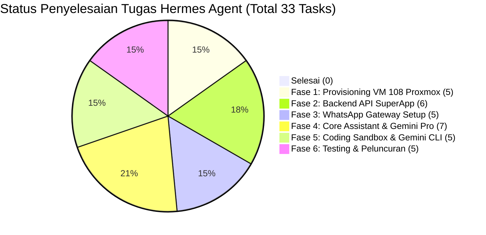

# Implementation Tasks & Checklist: Hermes Agent BKSDA Kaltim

> **Status Proyek**: SIAP DIKERJAKAN (Ready for Execution)  
> **Target**: VM 108 (`192.168.100.205`) pada Proxmox VE (`192.168.100.11`)  
> **Resource**: 16 GB RAM, 4 vCPU, 100 GB Disk  
> **Dokumen Terkait**: [requirements.md](requirements.md) | [design.md](design.md)

---

## Ringkasan Progres Fase

---

## Fase 1: Provisioning VM 108 di Host Proxmox (`192.168.100.11`)

- [ ] **1.1. Pembuatan VM Baru di Proxmox**
  - Buat VM dengan ID `108` dan nama `hermes-agent-dev`.
  - Sistem Operasi: Ubuntu Server 24.04 LTS (64-bit).
  - Alokasi CPU: 4 vCPU (Type: `host`).
  - Alokasi RAM: 16 GB (16384 MB).
  - Alokasi Storage: 100 GB NVMe pada `/dev/sda` local-lvm.
  - Alokasi Network: Bridge `vmbr0`, Static IP: `192.168.100.205/24`, Gateway: `192.168.100.1`, DNS: `8.8.8.8, 1.1.1.1`.
- [ ] **1.2. Konfigurasi Dasar & SSH Hardening**
  - Pasang public key SSH laptop developer di `~/.ssh/authorized_keys`.
  - Update repository & upgrade paket: `sudo apt update && sudo apt upgrade -y`.
  - Pasang firewall UFW: izinkan port `22` (SSH), `8080` (Evolution API dashboard LAN).
- [ ] **1.3. Instalasi Docker Engine & Docker Compose**
  - Install Docker Engine resmi dan Docker Compose plugin.
  - Tambahkan user ke grup docker: `sudo usermod -aG docker $USER`.
- [ ] **1.4. Instalasi Toolchain Pengembang**
  - Install Node.js 20.x LTS & npm.
  - Install PHP 8.2 CLI + ekstensi (`php8.2-cli`, `php8.2-curl`, `php8.2-mbstring`, `php8.2-xml`, `php8.2-zip`, `php8.2-pgsql`, `php8.2-sqlite3`).
  - Install Composer secara global.
  - Install GitHub CLI (`gh`).
- [ ] **1.5. Persiapan Direktori Penyimpanan Persisten Host**
  - Buat folder persistensi sesi di host Linux:  
    `sudo mkdir -p /opt/hermes/data/{evolution_instances,evolution_store,redis,logs}`
  - Atur izin akses agar dapat ditulis oleh container Docker (`chmod -R 775 /opt/hermes/data`).

---

## Fase 2: Implementasi Modul Agent di Backend BKSDA SuperApp (VM 106)

- [ ] **2.1. Pembuatan Direktori Modul Agent**
  - Buat folder `backend/app/Modules/Agent/` (Controllers, Routes, Requests, Middleware).
  - Daftarkan routing `/api/agent/v1` pada `AgentServiceProvider` atau `routes/api.php`.
- [ ] **2.2. Middleware Proteksi Whitelist IP LAN**
  - Buat middleware `RestrictAgentClientIp`: memvalidasi bahwa request hanya berasal dari IP `192.168.100.205` atau `127.0.0.1`.
- [ ] **2.3. Endpoint Verifikasi & Normalisasi Nomor Telepon (`verify-phone`)**
  - Implementasikan `POST /api/agent/v1/auth/verify-phone`.
  - Bersihkan format kotor (`08...`, `+628...`, spasi, strip) menjadi deretan digit murni (E.164).
  - Query pencocokan fleksibel PostgreSQL: `regexp_replace(telepon, '[^0-9]', '', 'g') LIKE %digits%` ke tabel `kpg_employees`.
  - Berikan panduan verifikasi NIP mandiri jika nomor belum terdaftar atau dipakai bersama.
- [ ] **2.4. Endpoint Saldo Cuti & Pengajuan Cuti Mandiri**
  - Implementasikan `GET /api/agent/v1/employees/{nip}/leaves`: membaca saldo hak cuti resmi.
  - Implementasikan `POST /api/agent/v1/leaves/request`: membuat pengajuan cuti dengan locking pesimistik `Employee::lockForLeaveUpdate()`.
- [ ] **2.5. Perlindungan Transaksi Idempoten (Anti-Duplikasi)**
  - Pasang verifikasi `idempotency_key` pada endpoint pengajuan cuti guna mencegah permohonan ganda akibat re-transmit sinyal WA.
- [ ] **2.6. Webhook Emisi Surat Tugas Baru**
  - Tambahkan event listener saat Surat Tugas berstatus `DITERBITKAN`: mengirimkan POST webhook payload ke `http://192.168.100.205:8080/webhook/st-published`.

---

## Fase 3: Deployment WhatsApp Gateway (Evolution API) & Registrasi Nomor

- [ ] **3.1. Konfigurasi `docker-compose.yml` di VM 108**
  - Buat direktori `/opt/hermes/gateway/`.
  - Tulis file `docker-compose.yml` dengan bind mount host `/opt/hermes/data/evolution_instances` dan `/opt/hermes/data/redis`.
  - Konfigurasi variabel environment API key dan URL server.
- [ ] **3.2. Menjalankan Container & Uji Koneksi Dashboard**
  - Jalankan `docker compose up -d`.
  - Pastikan container berstatus *Healthy* di port `8080`.
  - Buka dashboard Evolution API di `http://192.168.100.205:8080`.
- [ ] **3.3. Inisialisasi Instance WhatsApp & Scan QR Code**
  - Buat instance bot WhatsApp dengan nama `bksda-assistant`.
  - Pindai (Scan) QR code menggunakan nomor resmi/khusus asisten BKSDA.
  - Pastikan status koneksi instance berubah menjadi `open` / `connected`.
- [ ] **3.4. Uji Coba Kirim & Terima Pesan Sederhana**
  - Kirim pesan teks uji coba ke nomor pribadi developer via API cURL.
  - Pastikan pesan terkirim dengan tanda centang ganda.
- [ ] **3.5. Uji Ketahanan Sesi (Zero-Drop Reboot Test)**
  - Lakukan restart container Docker: `docker compose restart`.
  - Verifikasi status WhatsApp tetap `open` tanpa meminta scan QR code ulang.

---

## Fase 4: Pengembangan Hermes Assistant Core & Integrasi Gemini AI Pro

- [ ] **4.1. Setup Proyek Hermes Assistant Service**
  - Inisialisasi proyek di `/opt/hermes/assistant/` dengan package dependencies (FastAPI / Express, axios, `@google/genai`, ioredis).
  - Konfigurasi `GEMINI_API_KEY` untuk model Gemini 1.5 Pro / 2.0.
- [ ] **4.2. Implementasi System Prompt Persona BKSDA Kaltim**
  - Rancang System Prompt cerdas: Hermes sebagai asisten resmi yang ramah, sopan, paham istilah birokrasi KSDA (Balai, SKW, Resor, Polhut, Cuti, PerBKN, DIPA).
- [ ] **4.3. Implementasi Debounce Buffer & Concurrency Lock**
  - Pasang Redis Debounce Window 2 detik untuk menangani pesan terpisah yang dikirim berdekatan oleh staf.
  - Pasang Redis Mutex Lock (`lock:assistant:{phone}`) agar tidak terjadi race condition saat Gemini Pro sedang menyusun respons.
- [ ] **4.4. Implementasi Intent Parser & Fallback Pesan Non-Teks**
  - Memetakan intent teks: `CEK_CUTI`, `AJUKAN_CUTI`, `STATUS_ST`, `BUAT_ST_DRAFT`, `TANYA_INFO_UMUM`.
  - Menangani pesan suara (Voice Note) dan berkas media dengan respons penolakan sopan & panduan unggah via portal.
- [ ] **4.5. Implementasi State Machine & Confirmation Gatekeeper**
  - Mengelola sesi interaktif di Redis: `IDLE` $\rightarrow$ `COLLECTING_DATA` $\rightarrow$ `AWAITING_CONFIRMATION` $\rightarrow$ `EXECUTED`.
  - Menampilkan kartu rincian cuti / ST sebelum eksekusi ke database.
  - Memproses perintah `"YA"` / `"SETUJU"` untuk eksekusi, atau `"BATAL"` untuk membatalkan.
- [ ] **4.6. Resiliensi LLM: Circuit Breaker & Exponential Backoff**
  - Tangani eror HTTP 429 / 503 dengan 2x retry eksponensial.
  - Kirim pesan tanggap darurat jika kuota LLM habis agar bot tidak menggantung.
- [ ] **4.7. Implementasi Integrasi REST API BKSDA SuperApp & Webhook ST**
  - Hubungkan modul asisten ke endpoint `/api/agent/v1/*` menggunakan Sanctum token.
  - Menerima event ST diterbitkan dari SuperApp $\rightarrow$ kirim notifikasi WhatsApp dengan delay 1.5 detik antar-pesan.

---

## Fase 5: Setup Coding Agent Sandbox & Otomasi Gemini CLI

- [ ] **5.1. Setup Direktori Workspace Sandbox**
  - Buat direktori `/opt/hermes/coding-sandbox/workspace/`.
  - Clone repositori resmi: `git clone https://github.com/tegaranugrah1/bksda-superapp.git`.
  - Konfigurasi branch upstream `development`.
- [ ] **5.2. Konfigurasi Environment Pengujian Lokal di VM 108**
  - Setup file `.env.testing` di backend sandbox (SQLite in-memory atau Postgres dev).
  - Jalankan `composer install` dan `npm install`.
  - Jalankan `npx playwright install chromium` untuk headless browser testing.
- [ ] **5.3. Konfigurasi Gemini CLI**
  - Pasang dan autentikasi Gemini CLI di VM 108.
  - Uji eksekusi query Gemini CLI via terminal.
- [ ] **5.4. Pembuatan Script Otomasi Pipeline Git PR**
  - Buat skrip pembungkus `run-agent-task.sh`:
    1. Git checkout branch baru.
    2. Agent melakukan editing kode.
    3. Eksekusi `php artisan test` dan `npm run build`.
    4. Jika 100% lulus, eksekusi `git push` dan `gh pr create`.
    5. Kirim notifikasi ke WhatsApp developer bahwa PR siap direview.
- [ ] **5.5. Verifikasi Isolasi Air-Gap (Anti-Prompt Injection)**
  - Pastikan sandbox koding hanya dapat dipicu via SSH/terminal developer, tanpa rute atau listener dari pesan chat WhatsApp.

---

## Fase 6: Uji Coba Integrasi End-to-End, Beban, & Peluncuran

- [ ] **6.1. Pengujian Skenario Keamanan (Security Pentest)**
  - Uji kirim chat dari nomor HP yang tidak terdaftar di database $\rightarrow$ pastikan ditolak dengan sopan.
  - Uji pengajuan cuti tanggal lintas tahun kalender via WA $\rightarrow$ pastikan dicegat dengan pesan error ramah.
  - Uji penolakan konfirmasi (ketik "batal") $\rightarrow$ pastikan data tidak tersimpan di database.
- [ ] **6.2. Pengujian Edge-Cases Lapangan**
  - Uji *rapid double message*: kirim 2 pesan dalam selang 1 detik $\rightarrow$ pastikan digabungkan oleh debounce buffer.
  - Uji format nomor telepon kotor: kirim dari nomor dengan awalan `08`, `+62`, dan format strip di profil $\rightarrow$ pastikan teridentifikasi mulus.
  - Uji kirim *Voice Note* dan foto $\rightarrow$ pastikan mendapatkan pesan panduan yang ramah.
  - Uji reboot VM 108 $\rightarrow$ pastikan sesi WhatsApp langsung pulih tanpa scan QR ulang.
- [ ] **6.3. Uji Beban Simultan (RAM 16 GB Stress Test)**
  - Jalankan kompilasi `npm run build` di sandbox koding sambil melakukan chat bolak-balik di WhatsApp.
  - Pantau penggunaan memori (`htop` / `free -h`) $\rightarrow$ pastikan RAM tidak melebihi 14 GB dan bot WA tidak mengalami jeda/lag.
- [ ] **6.4. Uji Pergantian Nomor WhatsApp**
  - Uji logout sesi instance di Evolution API dan scan ulang QR nomor lain $\rightarrow$ pastikan sistem langsung tersambung kembali secara mulus.
- [ ] **6.5. Peluncuran Terbatas (Pilot Project)**
  - Daftarkan nomor WhatsApp 5 staf di Subbagian Tata Usaha sebagai peserta uji coba awal.
  - Kumpulkan masukan dan perbaiki respons bahasa agent sebelum diumumkan ke seluruh Balai dan SKW Wilayah.
