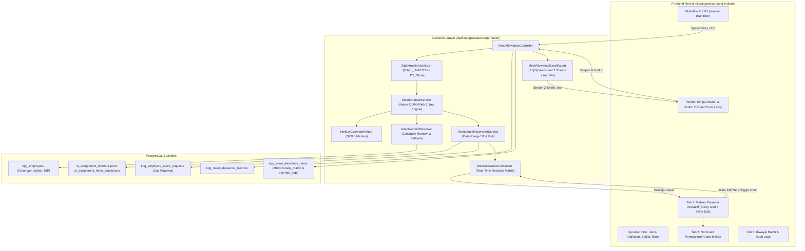

# Dokumen Desain Sistem & UI/UX - Fitur Hitung Uang Makan

## 1. Arsitektur Komponen Sistem



---

## 2. Detail Implementasi Tingkat Akar (Root Implementations)

### 2.1. Parser Native DOMXPath SIKADIR & ZIP Sanitizer
```php
// Penanganan file ZIP
$zip = new ZipArchive();
if ($zip->open($filePath) === true) {
    for ($i = 0; $i < $zip->numFiles; $i++) {
        $filename = $zip->getNameIndex($i);
        // Abaikan file sistem Apple / sampah ZIP
        if (str_starts_with($filename, '__MACOSX/') || str_ends_with($filename, '.DS_Store')) {
            continue;
        }
        $stream = $zip->getStream($filename);
        $content = stream_get_contents($stream);
        $this->parseSingleHtml($content, $filename);
    }
}

// Parser DOMXPath Native (2.36 ms per file)
libxml_use_internal_errors(true);
$dom = new DOMDocument();
$dom->loadHTML('<?xml encoding="utf-8" ?>' . $content);
libxml_clear_errors();
$xpath = new DOMXPath($dom);
```

### 2.2. Adaptive Tariff Resolver (PNS & PPPK Grade Mapping)
Menangani variasi data pada kolom `kpg_employees.pangkat_golongan`:
* **PNS Gol IV** (`Pembina (IV/a)`, `IV/b`, dll.) $\rightarrow$ Rp 41.000 / PPh 15%
* **PNS Gol III** (`Penata (III/c)`, `III/a`, dll.) $\rightarrow$ Rp 37.000 / PPh 5%
* **PNS Gol I-II** (`Pengatur (II/c)`, `II/a`, dll.) $\rightarrow$ Rp 35.000 / PPh 0%
* **PPPK Gol I-VIII** (`(I)`, `(III)`, `(V)`, dll.) $\rightarrow$ Rp 35.000 / PPh 0%
* **PPPK Gol IX-XII** (`(IX)`, `PPPK Golongan IX`, dll.) $\rightarrow$ Rp 37.000 / PPh 5%
* **PPPK Gol XIII-XVII** (`(XIII)`, dll.) $\rightarrow$ Rp 41.000 / PPh 15%
* **Fallback Metadata**: Jika `pangkat_golongan` kosong `''`, membaca atribut SIKADIR `KELAS JABATAN : 5` $\rightarrow$ PPPK Gol V (Rp 35.000 / PPh 0%).

### 2.3. Rekonsiliasi Rentang Tanggal Surat Tugas (*Date Range Overlap*)
```sql
SELECT st.id, st.nomor_surat, st.status,
       COALESCE(st_emp.tanggal_mulai, st.tanggal_mulai) as tgl_mulai,
       COALESCE(st_emp.tanggal_selesai, st.tanggal_selesai) as tgl_selesai
FROM st_assignment_letter_employees st_emp
JOIN st_assignment_letters st ON st_emp.assignment_letter_id = st.id
WHERE st_emp.employee_id = :employee_id
  AND :target_date BETWEEN DATE(COALESCE(st_emp.tanggal_mulai, st.tanggal_mulai))
                       AND DATE(COALESCE(st_emp.tanggal_selesai, st.tanggal_selesai))
  AND st.deleted_at IS NULL;
```

---

## 3. Skema Database Final

```sql
-- 1. Batch Rekapitulasi Presensi & Uang Makan Bulanan
CREATE TABLE kpg_meal_allowance_batches (
    id BIGSERIAL PRIMARY KEY,
    periode_bulan VARCHAR(7) NOT NULL, -- Format: 'YYYY-MM', misal '2026-09'
    nama_batch VARCHAR(255) NOT NULL,  -- Contoh: 'Rekapitulasi September 2026'
    total_pegawai INT NOT NULL DEFAULT 0,
    total_hari_kerja INT NOT NULL DEFAULT 22,
    total_bruto NUMERIC(15,2) NOT NULL DEFAULT 0,
    total_pph21 NUMERIC(15,2) NOT NULL DEFAULT 0,
    total_netto NUMERIC(15,2) NOT NULL DEFAULT 0,
    penandatangan_nama VARCHAR(255) NOT NULL DEFAULT 'Dheny Mardiono, S.Hut., M.Sc.',
    penandatangan_nip VARCHAR(50) NOT NULL DEFAULT '19750314 199903 1 004',
    status VARCHAR(50) NOT NULL DEFAULT 'draft', -- 'draft', 'final', 'dibayarkan'
    created_by BIGINT REFERENCES users(id) ON DELETE SET NULL,
    created_at TIMESTAMP WITHOUT TIME ZONE DEFAULT NOW(),
    updated_at TIMESTAMP WITHOUT TIME ZONE DEFAULT NOW()
);

-- 2. Detail Presensi & Perhitungan per Pegawai
CREATE TABLE kpg_meal_allowance_items (
    id BIGSERIAL PRIMARY KEY,
    batch_id BIGINT REFERENCES kpg_meal_allowance_batches(id) ON DELETE CASCADE,
    employee_id BIGINT REFERENCES kpg_employees(id) ON DELETE SET NULL,
    nip VARCHAR(30) NOT NULL,
    nama_lengkap VARCHAR(255) NOT NULL,
    jabatan VARCHAR(255) NULL,
    jenis_pegawai VARCHAR(20) NOT NULL DEFAULT 'PNS', -- 'PNS', 'PPPK'
    tahun_angkatan INT NULL,                           -- Ekstraksi digit 9-12 NIP
    satuan_kerja VARCHAR(255) NULL,
    golongan VARCHAR(50) NULL,
    
    -- Tarif Standar SBM & Pajak
    tarif_harian NUMERIC(10,2) NOT NULL DEFAULT 35000,
    persen_pph21 NUMERIC(5,2) NOT NULL DEFAULT 0, -- 0%, 5%, 15%
    
    -- Rekapitulasi Hari
    jml_hari_kerja INT NOT NULL DEFAULT 0,
    jml_hadir INT NOT NULL DEFAULT 0,
    jml_pd INT NOT NULL DEFAULT 0,
    jml_cuti INT NOT NULL DEFAULT 0,
    jml_sakit INT NOT NULL DEFAULT 0,
    jml_izin INT NOT NULL DEFAULT 0,
    jml_alpa INT NOT NULL DEFAULT 0,
    
    -- Nominal Keuangan
    uang_makan_bruto NUMERIC(15,2) NOT NULL DEFAULT 0,
    potongan_pph21 NUMERIC(15,2) NOT NULL DEFAULT 0,
    uang_makan_netto NUMERIC(15,2) NOT NULL DEFAULT 0,
    
    -- Detail Matriks Harian (Array JSON 1..31 hari)
    -- Format: {"1": "PD", "2": "PD", "3": "H", ..., "28": "PD"}
    daily_matrix JSONB NOT NULL DEFAULT '{}'::jsonb,
    
    -- Jejak Audit Rekonsiliasi & Override Manual
    -- Format: [{"day": 28, "original_status": "H", "final_status": "PD", "overridden_by": "system", "reference_st_nomor": "ST.204/2026", "timestamp": "2026-11-02 17:00:00"}]
    override_logs JSONB NOT NULL DEFAULT '[]'::jsonb,
    
    created_at TIMESTAMP WITHOUT TIME ZONE DEFAULT NOW(),
    updated_at TIMESTAMP WITHOUT TIME ZONE DEFAULT NOW()
);

CREATE INDEX idx_kpg_meal_items_batch ON kpg_meal_allowance_items(batch_id);
CREATE INDEX idx_kpg_meal_items_nip ON kpg_meal_allowance_items(nip);
CREATE INDEX idx_kpg_meal_batches_periode ON kpg_meal_allowance_batches(periode_bulan);
```

---

## 4. Format Ekspor Excel 2-Sheet Baku BKSDA

### Sheet 1: Matriks Rekapitulasi Presensi (`SEPT PPPK_BRI`)
* **Header Baris 1-3**: Judul resmi Balai KSDA Kalimantan Timur & Bulan Tahun.
* **Header Baris 4-5**: `No` (Col A), `Nama` (Col B), `Tanggal` (Col C s.d. AF/AG), `JML HARI` (Col AH), `Jumlah` (`Hadir`, `Alpa`, `Ijin`, `Sakit`, `PD`, `CT`).
* **Formula Excel Dinamis**:
  - Kolom Hadir: `=COUNTIF(C7:AF7, "H")`
  - Kolom Alpa: `=COUNTIF(C7:AF7, "A")`
  - Kolom PD: `=COUNTIF(C7:AF7, "PD")`
  - Kolom CT: `=COUNTIF(C7:AF7, "CT")`
* **Legenda di Kiri Bawah (Baris 25-31)**:
  `H = Hadir`, `TK = Tanpa Keterangan / Alpa`, `CT = Cuti`, `I = Ijin`, `PD = Perjalanan Dinas`, `S = Sakit`.
* **Tanda Tangan Tunggal di Kanan Bawah (Kolom AI)**:
  ```text
  Samarinda,    [Bulan] [Tahun]
  Kepala Subbagian Tata Usaha,


  Dheny Mardiono, S.Hut., M.Sc.
  NIP. 19750314 199903 1 004
  ```
* **Page Setup & Print Configuration**:
  ```php
  $sheet->getPageSetup()->setOrientation(\PhpOffice\PhpSpreadsheet\Worksheet\PageSetup::ORIENTATION_LANDSCAPE);
  $sheet->getPageSetup()->setFitToPage(true);
  $sheet->getPageSetup()->setFitToWidth(1);
  $sheet->getPageSetup()->setFitToHeight(0);
  ```

### Sheet 2: Daftar Nominatif Pembayaran Uang Makan
* **Header**: Daftar Nominatif Pembayaran Uang Makan Pegawai BKSDA Kaltim.
* **Kolom**: No, Nama Pegawai, NIP, Golongan, Jumlah Hari Hadir ($H$), Tarif Harian ($Rp$), Uang Makan Bruto ($Rp$), Potongan PPh 21 ($Rp$), Jumlah Bersih Diterima ($Rp$), Tanda Tangan.
* **Total Baris Bawah**: Formula `=SUM(...)` untuk total Bruto, Pajak, dan Netto.

---

## 5. UI/UX Interaktif (Sticky Grid & Real-Time Reactive)

* **Sticky Grid Navigation**:
  - Kolom `No` dan `Nama Pegawai / NIP` dipasang `sticky left-0` dan `sticky left-12` agar tetap terbaca saat admin melakukan *horizontal scroll* pada tanggal 20 s.d. 31.
  - Kolom `Hadir`, `PD`, `Netto` dipasang `sticky right-0` sebagai ringkasan instan.
* **Inline Cell Popover**:
  - Klik sel tanggal pegawai $\rightarrow$ popover instan untuk memilih kode kehadiran baru (`H`, `PD`, `CT`, `S`, `I`, `TK`, `-`).
  - Mengubah status sel langsung mengkalkulasi ulang nominal Bruto, PPh 21, dan Netto pada baris tersebut serta kartu metrik atas tanpa reload halaman.
