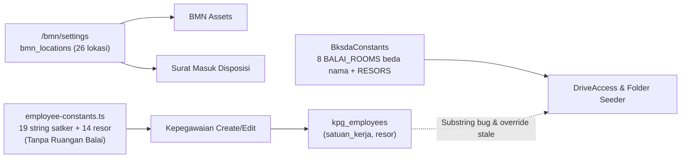
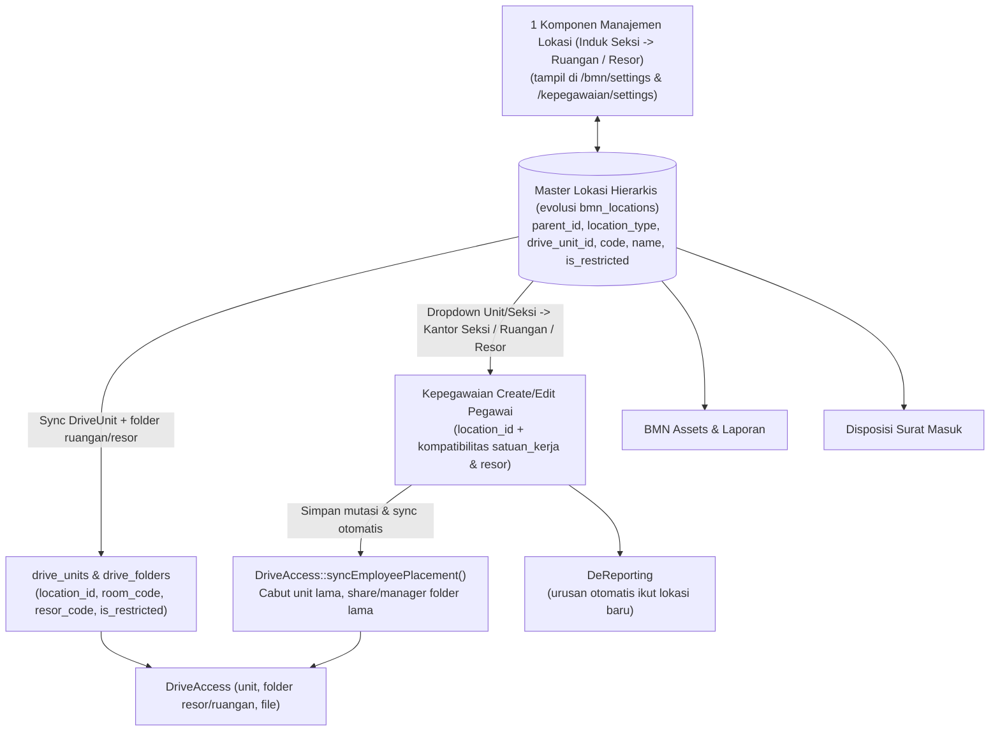

# Audit & Blueprint Arsitektur Terpadu: Master Lokasi, Penempatan Pegawai & Sinkronisasi BKSDA Drive

**Tanggal:** 2026-11-15  
**Cakupan:** Lintas Modul — **Master Lokasi (`bmn_locations`)**, **Kepegawaian** (`kpg_employees`, `EmployeeRequest`, `EmployeeController`, UI Create/Edit/Settings), **BKSDA Drive** (`DriveAccess`, `DriveController`, `DriveHierarchicalFoldersSeeder`), **BMN** (`/bmn/settings`, `bmn_assets`), **Surat Masuk** (`SuratMasukController::locations`), dan **DeReporting**  
**Status Dokumen:** Root-Cause Audit + Keputusan Arsitektur Terpadu (`/grill-me` Final)

---

## 1. Ringkasan Eksekutif & Keputusan Desain (`/grill-me`)

Saat memeriksa keterkaitan antara `/bmn/settings`, detail pegawai Kepegawaian, Surat Masuk, dan BKSDA Drive, ditemukan bahwa akar masalah paling mendasar bukan hanya bug pencocokan string di Drive, melainkan **adanya 3 sumber daftar unit/ruangan/resor yang terpisah dan tidak saling sinkron**:
1. **`bmn_locations`** ([`LocationController`](backend/app/Modules/Bmn/Controllers/LocationController.php), [`BmnMasterDataSeeder`](backend/database/seeders/BmnMasterDataSeeder.php)): berisi 4 unit, 8 urusan di Balai, kantor SKW I–III, dan Resor 01–14. Tabel ini sudah ikut dibaca oleh [`SuratMasukController::locations`](backend/app/Modules/Surat/Controllers/SuratMasukController.php#L116-L126) untuk disposisi surat.
2. **`BksdaConstants::BALAI_ROOMS` & `RESORS`** ([`BksdaConstants.php`](backend/app/Constants/BksdaConstants.php#L5-L34)) + [`DriveHierarchicalFoldersSeeder`](backend/database/seeders/DriveHierarchicalFoldersSeeder.php): memakai 8 nama ruangan Balai yang berbeda dari BMN (`Subbagian Tata Usaha`, `Urusan Keuangan & BMN`, `Ruang Kepala Balai`, dll.) plus `Resor 01–14`.
3. **Kepegawaian** ([`employee-constants.ts`](frontend/src/app/kepegawaian/_lib/employee-constants.ts#L5-L54)): memakai array statis `SATUAN_KERJA_OPTIONS` (19 string campuran Unit + Resor) dan `RESOR_OPTIONS`, serta **tidak memiliki kolom ruangan** untuk pegawai di Kantor Balai atau Kantor Seksi.

> **Baseline BKSDA Drive sebelumnya:** Audit keamanan & refactor internal BKSDA Drive + DeReporting sudah di-commit pada `31a0b7f3`, `1f1f5950`, dan `e894c26d` (72 test Drive/DeReporting PHPUnit lulus dengan 404 assertions).

### Keputusan Desain yang Telah Disepakati (`/grill-me`)
1. **Satu Sumber Master di Database:** Mengangkat dan menyempurnakan tabel **`bmn_locations`** menjadi **Master Hierarki 2 Level (`parent_id`: Balai/Seksi -> Ruangan & Resor)** yang menjadi *single source of truth* bagi Kepegawaian, BMN, Drive, Surat, dan DeReporting tanpa merusak data `bmn_assets.lokasi_ruang` yang sudah ada.
2. **Hierarki Eksplisit & 3 Jenis Tambah Data di UI:**
   - Level 1 (Induk, `parent_id = null`): **`balai`** dan **`seksi`** — di UI tersedia opsi **Tambah Unit/Seksi Baru** secara mandiri sebagai node induk (bukan row datar).
   - Level 2 (Turunan, wajib punya `parent_id`):
     - **`room` (Ruangan):** bisa diturunkan dari **`balai`** maupun dari **`seksi`**.
     - **`resor` (Resor):** **wajib turunan dari `seksi`** (ditolak jika induknya `balai`).
   - Penamaan awal memakai daftar `bmn_locations` saat ini lalu dilengkapi ruangan yang dipakai di Drive (`Ruang Kepala Balai`, `Ruang Pelayanan Publik`, dll.), tetap bisa ditambah/diubah lewat UI.
3. **Sinkronisasi Penuh Master Lokasi -> BKSDA Drive:**
   - Tambah **Seksi baru** otomatis membuat `DriveUnit` baru (+ folder bersama `Berkas Umum & Koordinasi <Nama Seksi>`).
   - Tambah/ubah nama/pindah Seksi untuk **Ruangan** atau **Resor** otomatis membuat, mengganti nama, memindahkan `unit_id`, dan menyinkronkan `is_restricted` pada folder di `drive_folders` (termasuk memindahkan akses pegawai jika Resor dialihkan ke Seksi lain).
   - Menghapus `DriveUnit::where('id', '>', 4)->delete()` di [`DriveHierarchicalFoldersSeeder`](backend/database/seeders/DriveHierarchicalFoldersSeeder.php#L33) agar `DriveUnit` Seksi baru buatan UI tidak ikut terhapus saat seeder dijalankan.
4. **Penempatan Detail Pegawai & Isolasi Folder Drive:**
   - Di Balai -> pilih **Kantor Balai (Umum)** atau salah satu **Ruangan** di bawah Balai.
   - Di Seksi -> pilih **"Kantor Seksi (Umum / Non-Resor)"**, **Ruangan Seksi** (jika ada), atau salah satu **Resor** turunan Seksi tersebut. Pegawai **Kantor Seksi (non-resor)** mendapat akses Unit Seksi & `Berkas Umum & Koordinasi Seksi`, **tidak** otomatis masuk ke folder Resor terisolasi.
   - Folder Resor (`folder_scope = 'resor'`) tetap terisolasi ketat per Resor; Folder Ruangan Balai (`folder_scope = 'ruangan'`) terisolasi per Ruangan pegawai (atau dikonfigurasi `is_restricted` per lokasi/folder), disertai folder bersama `Berkas Umum & Koordinasi Balai`.
5. **Pencabutan Akses Menyeluruh Otomatis Saat Mutasi:** Ketika pegawai mutasi Unit/Ruangan/Resor (atau dinonaktifkan), keanggotaan `drive_unit_members` lama, status owner/manager (`DriveFolder.user_id` & `DriveShare`) pada folder resor/ruangan lama dicabut otomatis, dan akses `DriveFile` di dalam folder Unit/Resor tunduk pada izin lokasi barunya (file pribadi di **My Drive** dengan `unit_id === null` tetap aman milik pegawai).
6. **Satu Settingan di UI:** Menggunakan **1 komponen manajemen lokasi terpadu** yang menampilkan struktur bertingkat Induk -> Ruangan/Resor dan membaca/menulis tabel master tunggal yang sama, dipasang sinkron di `/bmn/settings` maupun `/kepegawaian/settings` (hak tambah/ubah/hapus dibatasi untuk Super Admin / Admin Master berwenang agar konsisten lintas modul).

---

## 2. Alur Saat Ini vs Arsitektur Target

### Alur Saat Ini (Fragmented)

### Arsitektur Target (1 Sumber Kebenaran)

---

## 3. Daftar Lengkap 15 Akar Masalah (Root Causes — Standar 10/10)

### RC-1 (Critical / High): `DriveAccess::unitRole()` Gagal Mengenali Format `"Wil I/II/III"` dan Menyasarkan `Resor 05. Samarinda` ke Unit Balai
- **Lokasi:** [`DriveAccess::unitRole`](backend/app/Support/Security/DriveAccess.php#L68-L84) vs [`SATUAN_KERJA_OPTIONS`](frontend/src/app/kepegawaian/_lib/employee-constants.ts#L5-L28)
- **Akar masalah:** Dropdown memakai `"Seksi KSDA Wil I - Resor 03. Tanjung Selor"`, `"Seksi KSDA Wil II - Resor 05. Samarinda"`, `"Wil II - Resor 06..."`, `"Wil III - Resor 11..."`, sedangkan `unitRole()` hanya mencari `'wilayah i/ii/iii'`, `'skw i/ii/iii'`, atau kota induk.
- **Dampak:** Banyak staf Resor mendapat `unitRole = null` (Unit SKW hilang dari Drive), sedangkan staf **`Wil II - Resor 05. Samarinda`** cocok dengan `str_contains($sk, 'samarinda')` sehingga nyasar ke **Unit 1 Balai Samarinda**, bukan **Unit 3 SKW II Tenggarong**. *(Bug lolos dari [`DriveHierarchicalResorRBACTest`](backend/tests/Feature/DriveHierarchicalResorRBACTest.php#L108-L144) karena test memakai string contoh `'Seksi KSDA Wilayah I Berau'`.)*

### RC-2 (High): Validasi Silang `satuan_kerja` <-> `resor` di `EmployeeRequest` Mati Total & Salah Memblokir `Resor 05`
- **Lokasi:** [`EmployeeRequest.php`](backend/app/Modules/Kepegawaian/Requests/EmployeeRequest.php#L150-L169) vs [`BksdaConstants::RESORS`](backend/app/Constants/BksdaConstants.php#L7-L22)
- **Akar masalah:** Validasi membaca `$resorMeta['skw'] ?? 0`, padahal `BksdaConstants::RESORS` memakai `'unit_id'` dan `'skw_slug'`. Nilainya selalu `0`, sehingga validasi beda SKW tidak pernah aktif; sementara `str_contains($satker, 'samarinda')` justru salah memblokir `Wil II - Resor 05. Samarinda`.

### RC-3 (High): `drive_unit_members` Memblokir Efek Mutasi Karena Diprioritaskan Sebelum Data Pegawai
- **Lokasi:** [`DriveAccess::unitRole`](backend/app/Support/Security/DriveAccess.php#L62-L66) & [`EmployeeController::update`](backend/app/Modules/Kepegawaian/Controllers/EmployeeController.php#L229-L299)
- **Akar masalah:** `drive_unit_members` dicek lebih dulu daripada profil `Employee`, dan `EmployeeController::update()` tidak pernah membersihkan baris `drive_unit_members` unit lama saat pegawai mutasi.

### RC-4 (High): Status Owner / Manager Folder Resor (`DriveFolder.user_id` & `DriveShare`) Bertahan Pasca-Mutasi
- **Lokasi:** [`DriveController::assignManager`](backend/app/Http/Controllers/Api/DriveController.php#L1138-L1185) & [`DriveAccess::checkFolderAccess`](backend/app/Support/Security/DriveAccess.php#L133-L162)
- **Akar masalah:** `assignManager()` mengubah `drive_folders.user_id` ke pegawai dan membuat `DriveShare(role='manager')`. Kedua cek tersebut dijalankan sebelum cek resor pegawai di `checkFolderAccess()`, sehingga mantan Manager Resor tetap punya akses penuh ke folder resor lamanya setelah pindah.

### RC-5 (Medium-High): Bypass Pemilik Berkas (`DriveFile.user_id`) Mengalahkan Isolasi Folder Terisolasi / Unit
- **Lokasi:** [`DriveAccess::checkFileAccess`](backend/app/Support/Security/DriveAccess.php#L188-L223)
- **Akar masalah:** Baris 190 mengizinkan akses mutlak jika `$file->user_id === $user->id` sebelum mengecek `$file->folder` / `$file->unit`. Staf yang sudah mutasi masih bisa mengakses/membagikan berkas dinas yang dulu ia unggah di resor atau unit lamanya melalui direct file ID (`/api/drive/files/{id}/url`).

### RC-6 (Medium): Bug Filter & Stale State di UI Create & Edit Pegawai
- **Lokasi:** [`[id]/page.tsx`](frontend/src/app/kepegawaian/employees/[id]/page.tsx#L327-L343) (`L1466-L1500`) & [`create/page.tsx`](frontend/src/app/kepegawaian/employees/create/page.tsx#L149-L160) (`L548-L558`)
- **Akar masalah:** Kedua halaman memakai `.includes("wilayah i/ii/iii")` sehingga gagal memfilter `RESOR_OPTIONS` pada opsi `"Wil I/II/III"`, dan hanya mengosongkan `resor` ketika pindah ke Balai — bukan saat pindah antar-SKW.

### RC-7 (Medium): Fragmentasi 3 Master Ruangan/Lokasi (BMN, Drive, Kepegawaian) & Belum Ada Penempatan Ruangan untuk Pegawai Balai/Seksi
- **Lokasi:** `bmn_locations` (`BmnMasterDataSeeder`), `BksdaConstants::BALAI_ROOMS`, dan `kpg_employees` (hanya punya `satuan_kerja` & `resor`).
- **Akar masalah:**
  - Pegawai di Kantor Balai hanya tercatat sebagai `"Kantor Balai KSDA Kalimantan Timur"` tanpa tahu ruangan/urusannya (mis. `Urusan Kepegawaian`, `Urusan Keuangan`, `Ruang Kepala Balai`), sehingga folder ruangan Balai di Drive tidak bisa mengisolasi/menempatkan pegawai sesuai ruangannya.
  - Nama ruangan Balai di BMN (`bmn_locations`) dan Drive (`BALAI_ROOMS`) berbeda satu sama lain, serta aset BMN & Surat Masuk membaca `bmn_locations`, bukan konstan Kepegawaian/Drive.

### RC-8 (Low / Defense-in-Depth): Belum Ada Guard `is_active` Pegawai di `DriveAccess::getEmployee()`
- **Lokasi:** [`DriveAccess::getEmployee`](backend/app/Support/Security/DriveAccess.php#L35-L44) vs [`Employee::applyLifecycleStatus`](backend/app/Modules/Kepegawaian/Models/Employee.php#L634-L710)
- **Akar masalah:** `getEmployee()` mencocokkan `Employee::where('nip', $user->username)` tanpa memfilter `is_active = true`, dan mutasi `applyLifecycleStatus('deactivate')` belum membersihkan relasi/share eksplisit Drive.

### RC-9 (Critical): Eager Loading `.select([...])` pada `DriveController::index` Menghilangkan `location_id`, `room_code`, & `folder_scope`
- **Lokasi:** [`DriveController::index`](backend/app/Http/Controllers/Api/DriveController.php#L121-L124)
- **Akar masalah:** Relasi `$file->folder` di-load dengan `.select(['id', 'unit_id', 'user_id', 'parent_id', 'is_restricted', 'resor_code', 'deleted_at'])`. Kolom `location_id`, `room_code`, dan `folder_scope` tidak disertakan, sehingga saat `DriveAccess::canReadFile()` mengecek `$file->folder`, atribut `$folder->location_id` dan `$folder->room_code` bernilai `null` dan semua berkas di dalam folder Ruangan yang *restricted* akan hilang (`false`) saat listing.

### RC-10 (High): Ketidaksinkronan `urusan` DeReporting Laporan Internal (`InternalController` & `InternalUploadDrawer`)
- **Lokasi:** [`InternalController.php`](backend/app/Modules/DeReporting/Controllers/InternalController.php#L24) (`L247, L367, L396`) & [`InternalUploadDrawer.tsx`](frontend/src/app/dereporting/internal/_components/InternalUploadDrawer.tsx#L28-L36)
- **Akar masalah:** `InternalUploadDrawer.tsx` masih memakai array statis `URUSAN_OPTIONS` (bahkan bernama `"SKW II Samarinda"` & `"SKW III Sangatta"`), sementara `InternalController` mengambil `$userUrusan = $userEmployee?->resor ?: $userEmployee?->satuan_kerja`. Karena `employee->resor` berisi kode `'resor_01'`, pencocokan string tunggal terhadap `urusan_name` laporan gagal mengenali kesamaan antara kode resor, nama lokasi/ruangan, dan nama unit induk pegawai.

### RC-11 (High): Pewarisan Subfolder Saat `is_restricted = false` & Propagasi Rekursif Saat Update Lokasi/Move Folder
- **Lokasi:** [`DriveController::createFolder`](backend/app/Http/Controllers/Api/DriveController.php#L222-L227), [`DriveController::moveFolder`](backend/app/Http/Controllers/Api/DriveController.php#L1110-L1126), & [`LocationController::update`](backend/app/Modules/Bmn/Controllers/LocationController.php#L48-L78)
- **Akar masalah:** `createFolder` hanya mewariskan `folder_scope`, `resor_code`, dan `room_code` jika `$parentFolder->is_restricted` bernilai `true`. Jika ruangan Balai awalnya `is_restricted = false`, subfolder yang dibuat di dalamnya tidak memiliki `location_id`/`room_code`, sehingga saat ruangan diubah menjadi `is_restricted = true` (atau saat Resor dipindah ke Seksi lain / folder dipindah via `moveFolder`), pohon subfolder dan `DriveFile.unit_id` di dalamnya tidak ikut tersinkronisasi.

### RC-12 (Medium-High): `DriveShare` Level Berkas (`file_id`) di Dalam Folder Lokasi Lama Bertahan Pasca-Mutasi
- **Lokasi:** [`DriveAccess::checkFileAccess`](backend/app/Support/Security/DriveAccess.php#L195-L208)
- **Akar masalah:** `checkFileAccess()` memeriksa `$file->shares()` (direct file share) **sebelum** memeriksa `$file->folder`. Jika `syncEmployeePlacement()` hanya mencabut `DriveShare` pada `folder_id` tanpa mencabut `DriveShare` pada `file_id` di dalam pohon folder lokasi lama, pegawai yang dimutasi tetap bisa mengakses file dinas lama yang pernah di-share langsung kepadanya.

### RC-13 (Medium): Duplikasi Logika Atasan Cuti di Cetak Formulir Web & Mobile (`getKotaAtasanFromSatuanKerja`)
- **Lokasi:** [`FormulirCutiPrint.tsx`](frontend/src/app/portal/_components/FormulirCutiPrint.tsx#L57-L83) & [`FormulirCutiPrintModal.tsx`](mobile/src/components/FormulirCutiPrintModal.tsx#L93-L120)
- **Akar masalah:** Sama seperti `EmployeeLeaveRequestController::getAtasanLangsung`, kedua komponen cetak formulir cuti di Web dan Mobile hanya memeriksa `sk.includes("wilayah i/ii/iii")` dan gagal mengenali format `"Wil I/II/III"` atau nama resor, sehingga pejabat atasan pada cetakan cuti staf Resor jatuh ke default Kasubbag TU Samarinda.

### RC-14 (Medium): Halaman Detail/Edit Aset BMN (`bmn/assets/[id]/page.tsx`) Masih Hardcode `ALL_LOKASI_RUANG_OPTIONS`
- **Lokasi:** [`bmn/assets/[id]/page.tsx`](frontend/src/app/bmn/assets/[id]/page.tsx#L47-L53) vs [`location-options.ts`](frontend/src/app/bmn/_lib/location-options.ts#L57-L89)
- **Akar masalah:** Halaman detail/edit aset BMN sama sekali belum memanggil API lokasi dan hanya membaca array statis `ALL_LOKASI_RUANG_OPTIONS`, sehingga lokasi/ruangan/resor baru yang ditambahkan di Master Lokasi tidak pernah muncul saat mengedit aset.

### RC-15 (Medium): `EmployeeController::update` Belum Atomik (`DB::transaction`), Belum Melacak `location_id` di Audit History, & Cache `DriveAccess`
- **Lokasi:** [`EmployeeController::update`](backend/app/Modules/Kepegawaian/Controllers/EmployeeController.php#L229-L299) & [`DriveAccess::clearCache`](backend/app/Support/Security/DriveAccess.php#L21-L30)
- **Akar masalah:** `EmployeeController::update()` belum dibungkus `DB::transaction`, `$trackedFields` belum mencakup `'location_id'`, sinkronisasi perubahan NIP ke `User` berada di baris paling bawah setelah update, dan `DriveAccess::clearCache($targetUser)` belum dipanggil pasca-mutasi sehingga `WeakMap` cache berpotensi menahan evaluasi unit/folder lama dalam siklus request yang sama.

---

## 4. Blueprint Implementasi Terpadu (Single Source of Truth)

### Tahap 1 — Skema Master Lokasi Hierarkis (`bmn_locations`) & Penempatan Pegawai (`kpg_employees`)
1. **Perkaya tabel `bmn_locations` menjadi hierarki 2 level** (catatan skema krusial: `bmn_locations.id` bertipe **UUID** di [`2026_09_21_095000_create_bmn_master_data_tables.php`](backend/app/Modules/Bmn/Migrations/2026_09_21_095000_create_bmn_master_data_tables.php#L12-L15) dengan `name->unique()`, sehingga seluruh FK relasinya wajib bertipe **`uuid` (`foreignUuid`)**, bukan `bigint`):
   - `parent_id` (`nullable`, `foreignUuid -> bmn_locations.id`): `null` untuk induk Level 1 (`balai` / `seksi`); wajib terisi untuk Level 2 (`room` / `resor`).
   - `location_type` (`'balai' | 'seksi' | 'room' | 'resor'`)
   - `drive_unit_id` (`nullable`, FK/ID ke `drive_units`: `1=Balai`, `2=SKW I`, `3=SKW II`, `4=SKW III`, atau ID unit baru untuk Seksi yang dibuat dari UI)
   - `code` (`nullable`, unique string, mis. `'resor_01'`, `'urusan_kepegawaian'`, `'ruang_kepala_balai'`)
   - `is_restricted` (`boolean`, default `true` untuk `resor`, dapat dikonfigurasi untuk `room`, `false` untuk induk `balai`/`seksi`)
   - `is_active` (`boolean`, default `true`)
   - Migration/Seeder penyelarasan:
     - Buat node Level 1 (`Kantor Balai KSDA Kalimantan Timur` tipe `balai`, serta `Seksi KSDA Wilayah I/II/III` tipe `seksi`), lalu tautkan seluruh `room` & `resor` eksisting ke `parent_id` masing-masing (hilangkan duplikasi row Kantor SKW sebagai child datar jika sudah terwakili oleh node Level 1).
     - Tambahkan ruangan Balai yang diperlukan Drive (`Ruang Kepala Balai`, `Ruang Pelayanan Publik & Call Center`, dll.) + folder bersama `Berkas Umum & Koordinasi Balai` di Unit 1.
     - Hapus `DriveUnit::where('id', '>', 4)->delete();` di [`DriveHierarchicalFoldersSeeder`](backend/database/seeders/DriveHierarchicalFoldersSeeder.php#L33) agar `DriveUnit` Seksi tambahan dari UI aman saat seeder berjalan.
2. **Tambah `location_id` pada `kpg_employees` & `drive_folders` (`foreignUuid` -> `bmn_locations.id`):**
   - Pada `kpg_employees`: `location_id` nullable **`foreignUuid -> bmn_locations.id`** (`nullOnDelete`). Dapat menunjuk ke node Level 1 (`Kantor Balai` umum / `Kantor Seksi` non-resor) **atau** node Level 2 (`room` / `resor`).
   - Pada `drive_folders`: `location_id` nullable **`foreignUuid -> bmn_locations.id`** (`nullOnDelete`) agar folder organisasi terhubung langsung ke master tanpa mengandalkan string nama saja.
   - Penanganan `name->unique()` & relasi `Location::assets()`: pertahankan keunikan `bmn_locations.name` secara global (mis. ruangan Seksi diberi nama spesifik seperti `"Ruang TU Seksi I"`) agar `bmn_assets.lokasi_ruang` tetap 1-to-1 tanpa merusak aset lama.
   - Kolom lama `satuan_kerja` dan `resor` **tetap diisi otomatis** dari node lokasi & induknya saat `store`/`update` demi kompatibilitas penuh dengan Surat Tugas, Cuti, Uang Makan, DeReporting, BMN, Mobile, dan riwayat audit (`EmployeeHistory`), disertai backfill otomatis untuk pegawai eksisting.

### Tahap 2 — Validasi Hierarki & Sinkronisasi Master Lokasi -> BKSDA Drive (`LocationController`)
- **Validasi create/update di `LocationController`:**
  - `seksi` / `balai`: `parent_id` harus `null` (induk Level 1).
  - `room`: `parent_id` wajib menunjuk node `balai` atau `seksi`.
  - `resor`: `parent_id` **wajib menunjuk node `seksi`** (tolak `422` jika induknya `balai`, `room`, atau `resor`).
  - `unit_kerja` pada turunan otomatis disinkronkan dengan `name` dari induknya (dan jika nama induk `seksi`/`balai` diubah, ikut perbarui `unit_kerja` anak-anaknya serta `DriveUnit.name`).
- **Sinkronisasi penuh ke Drive saat `store`/`update` (termasuk propagasi rekursif ke pohon subfolder & berkas — RC-11):**
  - Tambah **`seksi`** -> otomatis buat `DriveUnit` baru + folder bersama `"Berkas Umum & Koordinasi {$location->name}"`, lalu simpan `drive_unit_id`.
  - Tambah/ubah **`room`** -> otomatis buat/perbarui `DriveFolder` root ruangan (`folder_scope = 'ruangan'`, `unit_id = parent.drive_unit_id`, `location_id`, `room_code = $location->code`, `is_restricted`), serta propagasikan perubahan `unit_id`, `location_id`, `room_code`, dan `is_restricted` ke **seluruh subfolder keturunan (`collectDescendantFolderIds`)** dan `DriveFile.unit_id` di dalamnya.
  - Tambah/ubah/pindah **`resor`** -> otomatis buat/perbarui `DriveFolder` root resor (`folder_scope = 'resor'`, `unit_id = parent.drive_unit_id`, `location_id`, `resor_code`, `is_restricted = true`). Jika `parent_id` (induk Seksi) berubah, pindahkan `unit_id` pada folder root Resor, **seluruh subfolder keturunannya**, dan **seluruh `DriveFile` di dalamnya** ke `DriveUnit` Seksi baru, perbarui `satuan_kerja` pegawai yang ditempatkan di resor tersebut, serta panggil `DriveAccess::syncEmployeePlacement()` untuk pegawai terkait.
- **Guard hapus (`destroy`):** tolak hapus bila masih punya turunan (`children_count > 0`), masih dipakai aset BMN (`assets_count > 0`), atau masih ditempati pegawai aktif (`kpg_employees.location_id`).

### Tahap 3 — Logika Otorisasi & Sinkronisasi Mutasi di [`DriveAccess`](backend/app/Support/Security/DriveAccess.php)
1. **`getEmployee(User $user)`:** Wajib memastikan pegawai berstatus aktif (`is_active = true`) dan memuat relasi `location.parent`.
2. **`unitRole(User $user, DriveUnit $unit)`:**
   - Turunkan `drive_unit_id` langsung dari Master Lokasi (`$employee->location?->drive_unit_id ?? $employee->location?->parent?->drive_unit_id` atau fallback `resor`/`satuan_kerja` yang sudah mendukung `"Wil I/II/III"` & memprioritaskan kode resor sebelum nama kota), bukan menebak string kota.
   - `drive_unit_members` hanya berperan untuk penugasan eksplisit sah dan otomatis dibersihkan untuk unit lama saat mutasi pegawai.
3. **`checkFolderAccess(User $user, DriveFolder $folder, bool $write)`:**
   - Untuk folder terisolasi (`is_restricted = true`): cek kecocokan `location_id` / `resor_code` / `room_code` milik folder dengan lokasi aktif pegawai (`$employee->location_id` / `resor` / `location->code`), ditambah `DriveShare` internal yang sah. Pegawai dengan `location_id` bertipe `seksi` (Kantor Seksi / non-resor) dapat mengakses Unit Seksi & `Berkas Umum & Koordinasi Seksi`, **tidak** otomatis masuk ke folder Resor terisolasi. Pegawai dengan `location_id` bertipe `balai` (Kantor Balai Umum) dapat mengakses Unit Balai & `Berkas Umum & Koordinasi Balai`, **tidak** otomatis masuk ke folder Ruangan Balai yang di-set `is_restricted = true`.
   - Kepemilikan `$folder->user_id` pada folder organisasi (`folder_scope IN ('resor', 'ruangan')`) tidak boleh tertinggal pada pegawai yang sudah mutasi.
4. **`checkFileAccess(User $user, DriveFile $file, bool $write)`:**
   - Bypass `(int) $file->user_id === (int) $user->id` **hanya berlaku** untuk file **My Drive pribadi** (`$file->unit_id === null` dan tidak berada di folder unit/terisolasi).
   - Untuk semua file di dalam Unit Kerja (`$file->unit_id !== null`) atau folder terisolasi (`is_restricted`), otorisasi wajib mengikuti izin folder/unit saat ini (`checkFolderAccess` / `canRead` / `DriveShare` aktif).
5. **`DriveAccess::syncEmployeePlacement(Employee $employee, ...)` (termasuk pencabutan File Shares & Invalidate Cache — RC-12 & RC-15):**
   - Dipanggil atomik dalam `DB::transaction` di `EmployeeController::update` (setelah sinkronisasi NIP ke `User` bila NIP ikut berubah) saat `location_id` / `satuan_kerja` / `resor` / `is_active` berubah, dan di `Employee::applyLifecycleStatus('deactivate')`:
     - Hapus `drive_unit_members` milik user untuk unit yang bukan penempatan barunya.
     - Kumpulkan folder root lokasi lama beserta **seluruh subfolder keturunannya** (`location_id = $oldLocationId`, `resor_code = $oldResor`, `room_code = $oldRoomCode`, atau descendant tree dari folder `folder_scope IN ('resor', 'ruangan')` milik lokasi lama):
       - Cabut `DriveShare` internal (`user_id = $user->id`) pada **seluruh folder/subfolder lokasi lama** (`whereIn('folder_id', $oldFolderIds)`).
       - Cabut `DriveShare` internal (`user_id = $user->id`) pada **seluruh berkas (`DriveFile`) di dalam pohon folder lokasi lama atau unit lama** (`whereIn('file_id', $oldFileIds)`) — menutup celah RC-12.
       - Jika `DriveFolder.user_id === $user->id` pada folder induk atau subfolder di lokasi lama tersebut, kembalikan `user_id` ke `super_admin`.
     - Panggil `DriveAccess::clearCache($user)` agar cache `WeakMap` langsung bersih pada siklus eksekusi yang sama.

### Tahap 4 — Konsumen Hilir Backend (Kepegawaian, Drive, Cuti, Surat, DeReporting, Mobile) & Frontend Lintas Modul
1. **Backend Deep Dependencies yang Wajib Ikut Diperbarui (Bukan Hanya Controller Update):**
   - **Master API & Middleware Permission (`backend/routes/api.php` vs `Bmn/Routes/api.php`):**
     - Saat ini [`Bmn/Routes/api.php`](backend/app/Modules/Bmn/Routes/api.php#L109-L112) mengunci `GET /bmn/locations` dengan `permission:bmn.view` dan `POST/PUT/DELETE` dengan `permission:bmn.asset.update` — artinya Admin Kepegawaian yang tidak punya modul BMN akan terkena **`403`**.
     - Solusi: buat endpoint global terotentikasi `GET /api/locations` (untuk semua user portal aktif / modul Kepegawaian, BMN, Surat, Drive, DeReporting) + `POST/PUT/DELETE /api/locations` (khusus `super_admin` atau permission master yang disepakati), sementara `/api/bmn/locations` & `/api/surat-masuk/locations` tetap dipertahankan sebagai alias kompatibel ke controller yang sama. Pastikan `SuratMasukController::locations()` tetap kompatibel dengan filter `DiteruskanCellPopover` (`unit_kerja` Balai mengandung `"Balai"`).
   - [`EmployeeRequest`](backend/app/Modules/Kepegawaian/Requests/EmployeeRequest.php) & [`EmployeeController::update`](backend/app/Modules/Kepegawaian/Controllers/EmployeeController.php#L229-L299) (**RC-2 & RC-15**):
     - Validasi `location_id` terhadap `bmn_locations` aktif, turunkan `satuan_kerja` + `resor` dari record Master Lokasi dan induknya (menggantikan pengecekan `$resorMeta['skw']` yang rusak). Pertahankan kompatibilitas bila klien **Mobile** ([`TambahPegawaiScreen.tsx`](mobile/src/features/kepegawaian/TambahPegawaiScreen.tsx), [`EmployeeDetailModal.tsx`](mobile/src/features/kepegawaian/EmployeeDetailModal.tsx)) belum mengirim `location_id` (resolve otomatis dari `satuan_kerja`/`resor`).
     - Bungkus `EmployeeController::update()` dalam `DB::transaction`, tambahkan `'location_id'` ke `$trackedFields` untuk `EmployeeHistory`, sinkronkan perubahan `nip` ke `User` terlebih dahulu bila berubah, lalu jalankan `DriveAccess::syncEmployeePlacement()`.
   - [`Employee.php`](backend/app/Modules/Kepegawaian/Models/Employee.php#L357-L406) (`is_seksi`, `seksi_wilayah`): prioritaskan relasi `location` (`location_type === 'seksi'` atau `parent.location_type === 'seksi'`) sebelum fallback string agar Surat Tugas (`EmployeeController::select` & `departure-helpers.ts`) tetap akurat termasuk jika Seksi baru ditambahkan.
   - [`EmployeeController::index`](backend/app/Modules/Kepegawaian/Controllers/EmployeeController.php#L80-L137) & [`dashboardStats`](backend/app/Modules/Kepegawaian/Controllers/EmployeeController.php#L903-L926): perbaiki filter `?wilayah=` (saat ini memakai `'%wilayah i %'` berspasi dan kehilangan `"Wil I/II/III"`, `"Tanjung Selor"`, `"Tarakan"`, `"Padang Luway"`, `"Teluk Adang"`, `"Teluk Apar"`, `"Paser"`) dan `satkerBreakdown` agar mendukung filter berdasarkan `location_id` / `parent_id` serta format baru.
   - [`EmployeeLeaveRequestController::getAtasanLangsung`](backend/app/Modules/Kepegawaian/Controllers/EmployeeLeaveRequestController.php#L1028-L1052): perbarui pencocokan `'wilayah i/ii/iii'` agar juga mengenali format `'wil i/ii/iii'` & `location` induk Seksi sehingga penentuan atasan pengajuan cuti tidak salah.
   - [`DriveController`](backend/app/Http/Controllers/Api/DriveController.php) (**RC-9 & RC-11**):
     - Di `DriveController::index` (baris 122): wajib tambahkan `'location_id'`, `'room_code'`, dan `'folder_scope'` ke dalam `.select([...])` pada eager loading `'folder' => fn ($q) => ...` agar `DriveAccess::canReadFile()` memiliki metadata folder lengkap.
     - Di `createFolder`, `moveFolder`, dan `restore`: selalu wariskan `location_id`, `room_code`, `resor_code`, dan `folder_scope` dari `$parentFolder` (meskipun `is_restricted` saat itu `false` agar jika kelak diaktifkan seluruh subfolder sudah memiliki identitas lokasi), propagasikan atribut tersebut ke seluruh descendant saat `moveFolder` masuk ke dalam folder ber-lokasi, serta tolak non-Admin memindahkan folder root terikat `location_id` ke luar unitnya.
   - [`InternalController.php`](backend/app/Modules/DeReporting/Controllers/InternalController.php) (**RC-10 — DeReporting Laporan Internal**):
     - Buat helper terpusat (mis. `$userEmployee-> matchingUrusanNames()`) yang menghimpun nama lokasi aktif (`location->name`), kode lokasi (`location->code`), nama induk (`location->parent->name`), `resor` (beserta label resminya), dan `satuan_kerja` pegawai. Gunakan daftar kandidat ini pada filter `whereIn` / pencocokan case-insensitive di `index()`, `previewFile()`, `candidateRecipients()`, dan `userCanAccessReport()` agar laporan yang ditujukan ke Urusan/Ruangan/Resor/Seksi langsung terbaca akurat sesuai lokasi terbaru pegawai.
2. **Frontend & Mobile Lintas Modul (Bukan Hanya `/bmn/settings` & `[id]/page.tsx`):**
   - Ekstrak `LocationManagementTab` ke komponen shared (mis. `@/components/settings/LocationManagementTab.tsx`) dan tampilkan sinkron di `/bmn/settings` maupun tab baru `"Lokasi & Ruangan"` di [`/kepegawaian/settings`](frontend/src/app/kepegawaian/settings/page.tsx).
   - Pada modal Tambah/Edit di `LocationManagementTab`: sediakan pilihan tipe aksi (**Tambah Seksi/Unit Baru**, **Tambah Ruangan**, **Tambah Resor**) di mana opsi **Resor** hanya menampilkan **Seksi** sebagai Induk, serta tampilkan daftar terkelompok **Induk (Balai/Seksi) -> Ruangan & Resor**. Batasi aksi tulis ke Super Admin (atau izin master berwenang) dan read-only bagi admin modul lain.
   - Di [`employees/create/page.tsx`](frontend/src/app/kepegawaian/employees/create/page.tsx) dan [`employees/[id]/page.tsx`](frontend/src/app/kepegawaian/employees/[id]/page.tsx): ubah input penempatan menjadi **2 dropdown berjenjang** langsung dari Master Lokasi API:
     1. **Unit Kerja (Induk Level 1):** `Kantor Balai` atau daftar `Seksi` (termasuk Seksi baru dari master).
     2. **Penempatan Detail (Ruangan / Kantor Seksi / Resor):** jika **Balai** -> `Kantor Balai (Umum)` atau salah satu **Ruangan** Balai; jika **Seksi** -> `Kantor Seksi (Umum / Non-Resor)`, **Ruangan Seksi**, atau **Resor** turunan Seksi tsb.
   - Di [`employees/page.tsx`](frontend/src/app/kepegawaian/employees/page.tsx#L491) (filter daftar pegawai) & [`EmployeeAuditHistoryTab.tsx`](frontend/src/app/kepegawaian/employees/_components/EmployeeAuditHistoryTab.tsx#L60): perbarui agar memakai data Master Lokasi dinamis (tidak tertinggal di array statis lama).
   - Di [`bmn/assets/page.tsx`](frontend/src/app/bmn/assets/page.tsx) & [`bmn/assets/[id]/page.tsx`](frontend/src/app/bmn/assets/[id]/page.tsx) (**RC-14**): hubungkan `bmn/assets/[id]/page.tsx` ke `useQuery` `/api/locations` (digabung dengan fallback opsi legacy `SIMAN_LOKASI_RUANG_OPTIONS` dari `location-options.ts`) agar lokasi/ruangan/resor baru muncul di form edit aset tanpa merusak nilai `lokasi_ruang` aset lama.
   - Di [`InternalUploadDrawer.tsx`](frontend/src/app/dereporting/internal/_components/InternalUploadDrawer.tsx#L28-L36) (**RC-10**): ambil daftar sasaran Urusan/Ruangan/Seksi/Resor secara dinamis dari `/api/locations` (dengan fallback aman) menggantikan `URUSAN_OPTIONS` statis.
   - Di [`FormulirCutiPrint.tsx`](frontend/src/app/portal/_components/FormulirCutiPrint.tsx#L57-L83) & [`FormulirCutiPrintModal.tsx`](mobile/src/components/FormulirCutiPrintModal.tsx#L93-L120) (**RC-13**): perbarui `getKotaAtasanFromSatuanKerja()` agar mengenali format `"wil i/ii/iii"`, nama kota/resor SKW I–III, dan unit induk Seksi.

---

## 5. Rencana Verifikasi 3 Lapis (BE, FE Build, dan Live E2E)

*(Status saat ini: **Selesai diimplementasikan & diverifikasi** pada branch `codex/portal-security-pentest` — commit `255539bd` dan tindak lanjut penyelarasan data legacy pegawai `06633dc5` beserta migrasi `2026_11_16_000001_sync_existing_employees_satuan_kerja_to_locations.php`; PHPUnit `LocationHierarchyAndDriveSyncTest` lulus 6 tests / 66 assertions dan Next.js build 86/86 pages hijau.)*

### A. Verifikasi Backend (PHPUnit terhadap Laravel Feature Tests)
1. **Hierarki Master Lokasi (Tambah Seksi & Resor Turunan Seksi):**
   - Tambah **Seksi baru** via API -> otomatis membuat `DriveUnit` baru + `Berkas Umum & Koordinasi <Seksi>` dan tersedia di Master Lokasi.
   - Tambah **Resor baru** dengan `parent_id` bertipe `balai` ditolak (`422`); dengan `parent_id` bertipe `seksi` berhasil dan otomatis membuat folder resor terisolasi di bawah `DriveUnit` Seksi induknya.
   - Hapus `Seksi` yang masih punya `Resor` / aset / pegawai ditolak (`422`).
2. **Sinkronisasi Rename, Toggle `is_restricted`, & Pindah Induk -> BMN, Surat & Drive (Termasuk Pohon Subfolder):**
   - Mengubah nama ruangan/resor, mengubah `is_restricted`, atau memindahkan resor ke seksi lain memperbarui `bmn_assets.lokasi_ruang`, `/surat-masuk/locations`, `Employee` terkait, serta `name`, `unit_id`, `location_id`, `room_code`/`resor_code`, dan `is_restricted` pada folder root **beserta seluruh subfolder keturunan & berkasnya**.
3. **Penempatan Balai (Ruangan) vs Kantor Seksi (Non-Resor) vs Resor (`DriveAccess` & `DriveController::index`):**
   - Pegawai Balai di `Urusan Kepegawaian` dapat mengakses `Berkas Umum & Koordinasi Balai` + folder & berkas `Urusan Kepegawaian` (termasuk memverifikasi berkas tampil di `GET /api/drive` berkat select `location_id` & `room_code` — RC-9), serta terisolasi dari ruangan restricted lain tanpa share.
   - Pegawai `Kantor Seksi (Umum / Non-Resor)` masuk ke Unit Seksi & `Berkas Umum & Koordinasi Seksi`, ditolak (`403`) di folder Resor terisolasi.
   - Pegawai `SKW II` di `Resor 05. Samarinda` masuk ke Unit `SKW II Tenggarong` + folder `Resor 05. Samarinda`, ditolak (`403`) di Unit `Balai Samarinda` maupun resor lain.
4. **Mutasi Antar-Lokasi (Mantan Manager, Folder & File Shares Lama, DeReporting, Cuti & Filter Pegawai):**
   - Pegawai A (Manager folder lokasi lama via `assignManager` yang sudah upload file dinas dan memiliki `DriveShare` level folder & file di lokasi lama) dimutasi via `PUT /api/kepegawaian/employees/{id}`.
   - Verifikasi pasca-mutasi: unit baru & folder lokasi baru langsung aktif; unit lama, `drive_unit_members` lama, `DriveShare` manager folder lama, `DriveShare` file lama (RC-12), kepemilikan `DriveFolder.user_id`, dan akses file dinas di lokasi lama semuanya ditolak (`403`); sedangkan file pribadi di **My Drive** (`unit_id = null`) tetap dapat diakses.
   - Verifikasi visibilitas laporan terbatas `urusan` di DeReporting (`GET /api/dereporting/internals`) otomatis mengikuti lokasi baru pegawai (RC-10).
   - Verifikasi `Employee::is_seksi`, `seksi_wilayah`, filter `GET /api/kepegawaian/employees?wilayah=...`, `EmployeeHistory` (`location_id`), dan pengajuan cuti (`getAtasanLangsung`) tetap akurat.
5. **Deaktivasi Pegawai (`lifecycle`) & Regresi:** Nonaktifkan pegawai memutus seluruh akses Drive; jalankan suite PHPUnit Drive + DeReporting + Employee + BMN + Surat Masuk.

### B. Verifikasi Frontend (Typecheck, Build & Konsistensi UI)
1. `cd frontend && npm run build` (memastikan zero TypeScript / Next.js compile error pada `/bmn/settings`, `/kepegawaian/settings`, `/kepegawaian/employees/create`, `/kepegawaian/employees/[id]`, `/kepegawaian/employees`, `/bmn/assets`, `/bmn/assets/[id]`, `/dereporting/internal`, `/portal`, `/surat/masuk`).

### C. Verifikasi E2E Secara Live (Next.js `:3000` + Laravel API `:8000` + PostgreSQL `:5432` via Playwright)
Buat skrip Playwright live full-stack mengikuti pola [`portal-notifications-live-e2e.playwright.cjs`](frontend/tests/portal-notifications-live-e2e.playwright.cjs#L1-L60) (**tanpa mock `page.route()`**, membuat sandbox record via Laravel bootstrap dan menghapus sandbox di blok `finally`), serta jalankan ulang suite keamanan terkait (`drive-security-ui.playwright.cjs`, `bmn-security-ui.playwright.cjs`, `kepegawaian-detail-fullscreen.playwright.cjs`, `dereporting-internal-rbac.playwright.cjs`):
1. **Live UI Master Lokasi (`/bmn/settings` & `/kepegawaian/settings`):** Buka kedua UI dengan akun Super Admin (dan uji Admin Kepegawaian non-BMN tidak mendapat `403` saat membaca master); tambah Seksi sandbox & Resor turunan Seksi via modal UI (verifikasi dropdown Induk Resor hanya menampilkan Seksi), lalu cek munculnya di dropdown BMN Aset (`/bmn/assets` & `/bmn/assets/[id]`), DeReporting Internal, & Disposisi Surat Masuk.
2. **Live UI Create & Mutasi Pegawai -> Live Drive Access (`/kepegawaian/employees/[id]` -> `/drive`):**
   - Ubah penempatan pegawai sandbox dari Resor/Ruangan A (yang sudah punya subfolder & file dinas) ke Resor/Ruangan B via UI Detail Pegawai dan simpan.
   - Login sebagai pegawai sandbox tersebut di browser live (`http://localhost:3000/drive`), pastikan Unit & folder/berkas baru langsung tampil, folder/subfolder/file lokasi lama tidak tampil dan mengembalikan `403` saat diakses langsung, serta tidak ada console/500 API error.
3. **Cleanup:** Pastikan seluruh user/pegawai/lokasi/folder sandbox dihapus di blok `finally` agar database `:5432` kembali bersih.
