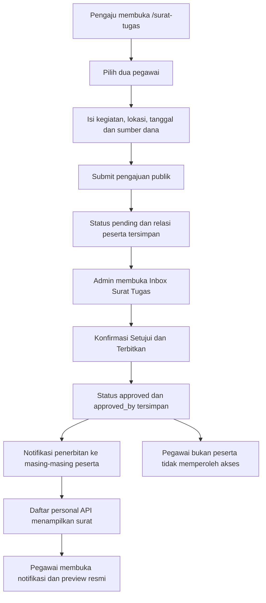

# Pengujian UI/UX dan alur Surat Tugas

Tanggal: 31 Oktober 2026  
Baseline aplikasi: `89ca78e7` pada `codex/portal-security-pentest`  
Status: **happy path pengajuan publik → approve → dua akun pegawai berhasil; terdapat temuan dan cakupan lanjutan yang belum diuji**.

Dokumen ini melengkapi, bukan menggantikan, [rencana pentest](../security/surat-tugas-security-pentest-plan.md) dan [laporan remediasi](../security/surat-tugas-security-pentest-2026-10-31.md). Kata sandi, token, NIP, dan isi akun pegawai tidak dicatat di sini.

## 1. Apa yang dimaksud pengujian lengkap?

- **Unit test** menguji aturan kecil secara terisolasi: permission, pembentukan diktum, pemetaan payload, dan aturan status. Unit test tidak membuktikan tampilan atau distribusi surat antar-akun.
- **Feature/integration test** menguji endpoint, autentikasi, database, relasi peserta, transaksi, dan notifikasi.
- **Browser E2E** membuka aplikasi asli dan menggunakan kontrol UI untuk mengajukan dan menyetujui surat, kemudian membuka akun peserta yang berbeda. API assertion dipakai untuk memeriksa keadaan yang tidak langsung terlihat di layar.
- **UI/UX review** memeriksa responsivitas, keterbacaan, label, keyboard, pesan validasi, status loading, navigasi, dan konsistensi preview/cetak.

Satu suite hijau tidak berarti seluruh kategori di atas sudah lengkap.

## 2. Lingkungan dan batas keselamatan

- Frontend asli: `http://localhost:3000`.
- Backend yang teramati saat login: localhost, port 8000.
- Konfigurasi DB lokal yang diperiksa: PostgreSQL, `127.0.0.1:5435`, database `bksda_superapp`; `DB_URL` tidak terisi. Ini pemeriksaan konfigurasi, bukan pembuktian konfigurasi server produksi.
- Browser: Google Chrome headless melalui Playwright yang sudah terpasang.
- Sesi browser dipisah untuk admin, dua peserta, pegawai bukan peserta, dan pengaju anonim.
- Tidak mengubah password, hak akses, biodata, konfigurasi aplikasi, atau surat operasional.
- Tidak menggunakan akun superadmin sebagai pengganti peserta biasa. Role peserta dibaca dan diverifikasi sebelum membuat surat.
- Pengujian ini menggunakan akun pegawai lokal yang diizinkan pengguna, bukan akun dummy baru. Sebaiknya pengujian berikutnya menggunakan tiga akun QA khusus pada database disposable.
- Seluruh surat uji diberi marker unik `TEST-E2E-ST-*`, keterangan pengujian, dan tanggal jauh di masa depan (`2099-12-01`) agar tidak dianggap perjalanan operasional.
- Runner hanya menerima hostname localhost dan memerlukan opt-in `ST_E2E_ALLOW_WRITE=1`. **URL localhost saja tidak menjamin DB di belakangnya lokal**: operator tetap wajib memeriksa koneksi DB sebelum menjalankan ulang.
- Cleanup melakukan soft-delete hanya pada ID yang dibuat runner dan setelah marker diperiksa kembali. Tidak melakukan bulk-delete, permanent-delete, atau menghapus riwayat audit/notifikasi.
- Pengujian memakai submit tanpa lampiran. Tidak ada klaim S3/Drive, PDF bertanda tangan, email eksternal, atau layanan produksi telah diuji.

## 3. Alur aktual aplikasi



Pada jalur yang diuji, **approve sekaligus menerbitkan**. Tidak ada tahap terpisah setelah approve untuk membuat surat terlihat di akun pegawai. Endpoint personal list menerima status `approved` dan beberapa alias status terbit. Tampil dalam preview tidak membuktikan adanya PDF final yang sudah ditandatangani secara elektronik.

## 4. Hasil browser E2E yang dijalankan

Runner: [`frontend/tests/surat-tugas-flow.playwright.cjs`](../../frontend/tests/surat-tugas-flow.playwright.cjs).

| ID | Skenario | Hasil dan bukti |
|---|---|---|
| FLOW-01 | Login melalui UI admin | PASS; HTTP 200, masuk `/portal` |
| FLOW-02 | Login dua peserta dan satu pegawai bukan peserta | PASS; tiga browser context terpisah, role non-admin |
| FLOW-03 | Pengajuan anonim dari UI `/surat-tugas`, dua peserta, DIPA | PASS; POST submit 201 dan layar `Berhasil Disubmit!` |
| FLOW-04 | Status awal dan peserta tersimpan | PASS; detail admin menunjukkan `pending` dan tepat dua peserta |
| FLOW-05 | Surat pending belum ada di daftar surat terbit peserta | PASS; API personal list kedua peserta tidak memuat ID surat |
| FLOW-06 | Admin menemukan pengajuan melalui pencarian inbox | PASS; membuka pengajuan dari UI asli |
| FLOW-07 | Membatalkan dialog penerbitan | PASS; status tetap `pending` |
| FLOW-08 | Menyetujui dan menerbitkan melalui UI | PASS; request approve 200, status `approved`, `approved_by` terisi |
| FLOW-09 | Surat muncul pada personal list dua peserta | PASS; API `/surat-tugas/my` masing-masing peserta memuat ID yang sama |
| FLOW-10 | Notifikasi penerbitan → preview pada dua peserta | PASS; setelah reload, klik notifikasi di portal asli membuka `#print-letter-area` dan memuat marker kegiatan |
| FLOW-11 | Pegawai ketiga tidak melihat surat dan tidak dapat membuka detail | PASS; tidak ada di personal list, detail personal HTTP 403 |
| FLOW-12 | Unhandled browser errors pada context yang dipantau | PASS; 0 pada halaman publik dan sesi admin/peserta yang dibuat runner |
| FLOW-13 | Cleanup terbatas pada surat uji | PASS; satu surat bertanda dipindahkan ke Sampah |
| FLOW-14 | Kelengkapan nomor surat saat terbit | **TEMUAN**; UI mengizinkan penerbitan walaupun nomor surat belum terisi |

Bukti identitas data uji (bukan kredensial):

- Marker: `TEST-E2E-ST-1793446948780`.
- ID: `01a191c5-1851-725a-a2f6-2086ef1579ab`.
- Status sesudah pengujian: **di Sampah**, bukan surat aktif.
- Notifikasi pengajuan/penerbitan uji dan audit trail tetap tersimpan. Sebagian notifikasi peserta telah ditandai dibaca melalui klik UI.

Batas pembuktian FLOW-09/10: keberadaan di daftar diperiksa melalui API; notifikasi dan preview diperiksa melalui UI. **Belum ada assertion terpisah pada baris daftar riwayat GUI.** Browser peserta di-reload setelah penerbitan, sehingga hasil ini membuktikan notifikasi tersimpan dan navigasinya, **bukan jaminan WebSocket/push tanpa refresh**. Kedua peserta adalah sampel dua akun, bukan seluruh roster pegawai.

Iterasi awal runner menemui error harness: response body login hilang setelah redirect, kandidat ternyata admin, dan selector sumber dana tidak sesuai casing/data aktual. Ketiganya diperbaiki pada runner; bukan dihitung sebagai bug aplikasi. Tidak ada surat dibuat pada iterasi tersebut. Satu eksekusi berikutnya menuntaskan alur di atas.

## 5. Unit dan feature test yang benar-benar dijalankan ulang

Suite terpilih dijalankan dalam Docker `bksda-security-sandbox:php84`:

- PHP 8.4.27, PHPUnit 12.5.40.
- `--network none`, source read-only, scratch sementara, limit resource.
- `APP_ENV=testing`, SQLite `:memory:`, mail array, broadcast log; tidak memakai DB lokal/produksi untuk suite ini.
- Filter: `UserPermissionFallbackTest|SuratTugasMobileListApiTest`.

**Hasil: 15 tests, 85 assertions, lulus; durasi 15,739 detik.**

| Suite | Jenis | Cakupan |
|---|---|---|
| `UserPermissionFallbackTest` | Unit, 9 tes | Hak akses dan fallback role/module, termasuk izin approve Surat Tugas |
| `SuratTugasMobileListApiTest` | Feature, 6 tes | Management list/detail, personal list/detail, penolakan bukan peserta, status-count dan bulk trash/restore pada fixture |

Perintah PHPUnit di dalam sandbox yang sudah disiapkan:

```sh
php vendor/bin/phpunit --do-not-cache-result --filter 'UserPermissionFallbackTest|SuratTugasMobileListApiTest'
```

Jangan menjalankan suite yang membuat/menghapus schema terhadap DB operasional. `phpunit.xml` memakai SQLite memory; periksa juga override environment dan cached config sebelum mengeksekusi.

Eksekusi awal yang juga mencakup `SuratTugasSecurityPentestTest` dihentikan pengguna sebelum selesai. Container milik pengujian tersebut kemudian dihentikan. **Tidak ada klaim suite keamanan itu lulus dari sesi ini.** Tes full-schema, concurrency PostgreSQL dan seluruh suite lainnya tidak dijalankan ulang.

Validasi runner: `node --check` dan ESLint lulus. Tidak menjalankan build/typecheck aplikasi penuh karena perubahan hanya runner CommonJS, npm script, dokumentasi dan screenshot.

## 6. UI/UX: pemeriksaan langsung dan temuan

### Hasil yang diamati pada browser

1. **Overflow pada ponsel 375 px.** `document.documentElement.scrollWidth` = 401 px; navigasi header `Login Pegawai` melebar ke kanan. Ini menyebabkan horizontal overflow. Layar desktop 1440 px tidak menunjukkan overflow pada pemeriksaan yang sama.
2. **Pencarian pegawai tidak memiliki accessible name.** Input awal tidak mempunyai label yang terasosiasi, `aria-label`, atau `aria-labelledby`; hanya placeholder panjang. Placeholder terpotong pada ponsel. Tambahkan label terlihat dan asosiasi `htmlFor`/`id` atau label pembungkus.
3. **Penerbitan tanpa nomor surat berhasil.** Konfirmasi UI menyatakan nomor/stempel akan dikunci, tetapi surat tanpa nomor tetap menjadi `approved`. Jika nomor adalah syarat surat resmi, validasi harus berada di backend dan UI mengarahkan admin melengkapi builder.
4. **Alur bertahap dan feedback sukses bekerja pada happy path desktop.** Tombol lanjut awal disabled sebelum ada peserta; pemilihan dua peserta, form detail, layar sukses, dialog konfirmasi, cancel, serta navigasi notifikasi berhasil digunakan runner.

Screenshot halaman publik, tanpa biodata/akun pegawai:

- [Desktop 1440 px](surat-tugas-public-1440.png).
- [Ponsel 375 px](surat-tugas-public-375.png).

### Risiko berdasarkan pemeriksaan source, belum direproduksi browser pada sesi ini

| Prioritas | Temuan source | Lokasi dan tindak lanjut |
|---|---|---|
| Tinggi | Builder mengirim `maksud_tujuan`, sedangkan handler approve membaca `nama_kegiatan`. Perubahan isi melalui `Perbarui & Ajukan` berpotensi tidak tersimpan | `SuratTugasForm.tsx` sekitar 2127–2157 dan handler submit edit; `AssignmentLetterController::approve` sekitar 1185–1258. Tambah tes edit → submit → reload |
| Tinggi | `Simpan Draft` memanggil `buildPayload()` tanpa status `draft`; pembuatan baru default ke `pending` | `SuratTugasForm.tsx` sekitar 2162–2195, default status controller store. Uji PLH/create terpisah karena bukan jalur publik yang diuji di atas |
| Sedang | Portal tidak meneruskan `template_snapshot`/`template` ke komponen preview | `portal/page.tsx` sekitar 807–832; preview menggunakan konfigurasi tersebut. Bandingkan template custom admin dan peserta sebelum menyatakan parity |
| Sedang | Riwayat portal meminta 20 surat dan tidak meneruskan metadata pagination | `portal/page.tsx` sekitar 295–310 dan `SuratTugasTab.tsx`. Uji akun dengan lebih dari 20 surat |
| Sedang | Pending/rejected tidak ada di daftar surat terbit meskipun ada notifikasinya | `AssignmentLetterController::myLetters` dan notifikasi store/update. Pertimbangkan riwayat pengajuan terpisah; ini kebutuhan UX, tidak otomatis bug filter surat terbit |
| Rendah | Tombol `Kembali ke Portal` untuk user biasa menuju `/`, bukan `/portal` | `SuratTugasSuccessStep.tsx` sekitar 35–46. Tambah pengujian pengajuan dalam keadaan login |

Temuan ini belum diperbaiki pada pekerjaan pengujian ini. Jangan menyamakan pemeriksaan source dengan bukti browser red/green.

## 7. Cara menjalankan ulang browser E2E

Prasyarat: aplikasi lokal hidup, Playwright dependency sudah terpasang, Google Chrome tersedia, akun QA dapat login tanpa memerlukan perubahan password atau challenge 2FA interaktif, serta database lokal/disposable sudah diperiksa.

Runner memakai environment berikut:

| Variable | Kegunaan |
|---|---|
| `ST_E2E_ADMIN_USERNAME` | Username admin QA |
| `ST_E2E_ADMIN_PASSWORD` | Password admin, hanya di environment proses |
| `ST_E2E_EMPLOYEE_PASSWORD` | Password bersama untuk tiga akun QA pada runner sederhana ini |
| `ST_E2E_EMPLOYEE_NIPS` | Opsional: tiga NIP dipisahkan koma; urutan dua peserta lalu satu bukan peserta |
| `ST_E2E_ALLOW_WRITE` | Harus `1`; membuat satu pengajuan dan notifikasi lokal nyata |
| `ST_E2E_URL` | Opsional, default `http://localhost:3000`; hanya localhost |
| `ST_E2E_DATE` | Opsional, default `2099-12-01` |

Tanpa NIP eksplisit, runner memeriksa paling banyak 12 kandidat nonstruktural dari selector dan memakai tiga akun dengan role bukan admin. Runner **tidak** membuat akun atau menebak/mengganti password. Untuk pengujian berulang, gunakan NIP QA eksplisit agar tidak mengganggu akun operasional.

Contoh PowerShell dari direktori `frontend` menggunakan prompt, tanpa menulis password ke file:

```powershell
$env:ST_E2E_ADMIN_USERNAME = Read-Host 'Username admin QA'
$env:ST_E2E_ADMIN_PASSWORD = [System.Net.NetworkCredential]::new('', (Read-Host 'Password admin QA' -AsSecureString)).Password
$env:ST_E2E_EMPLOYEE_PASSWORD = [System.Net.NetworkCredential]::new('', (Read-Host 'Password tiga pegawai QA' -AsSecureString)).Password
$env:ST_E2E_EMPLOYEE_NIPS = Read-Host 'Tiga NIP QA dipisahkan koma'
$env:ST_E2E_ALLOW_WRITE = '1'
try {
    npm run test:surat-tugas-flow
} finally {
    Remove-Item Env:ST_E2E_ADMIN_PASSWORD -ErrorAction SilentlyContinue
    Remove-Item Env:ST_E2E_EMPLOYEE_PASSWORD -ErrorAction SilentlyContinue
    Remove-Item Env:ST_E2E_ALLOW_WRITE -ErrorAction SilentlyContinue
}
```

Exit 0 menyatakan assertion happy path lulus. Output `FINDING` tetap harus ditinjau; exit 0 bukan persetujuan kesiapan rilis atau audit lengkap. Cleanup berjalan pada blok finally; jika cleanup gagal, runner menampilkan ID/marker untuk penanganan manual dan mengembalikan exit nonzero.

## 8. Matriks lanjutan sebelum sign-off penuh

| ID | Pengujian lanjutan | Status |
|---|---|---|
| EXT-01 | Ajukan dalam keadaan login dan kembali ke portal | Belum diuji |
| EXT-02 | Validasi kosong, tanggal terbalik, peserta ganda/tidak aktif | Belum diuji pada browser |
| EXT-03 | DIPA/FOLU/anggaran lain dan pemilihan template otomatis | DIPA happy path saja |
| EXT-04 | Edit builder, simpan, ajukan ulang, reload dan bandingkan setiap field | Belum diuji |
| EXT-05 | Draft tidak mengirim notifikasi atau masuk surat terbit | Belum diuji |
| EXT-06 | Reject, alasan penolakan, revisi dan resubmit | Belum diuji |
| EXT-07 | Tanggal berbeda per peserta, PLH dan tenaga lapangan | Belum diuji |
| EXT-08 | Konflik jadwal/cuti dan dua admin approve bersamaan | Belum dijalankan ulang |
| EXT-09 | Unggah PDF/JPEG/PNG/WebP, batas 10 MB, MIME tidak sesuai | Belum diuji pada alur browser ini |
| EXT-10 | Notifikasi/live inbox tanpa reload dan reconnect WebSocket | Belum diuji |
| EXT-11 | Baris riwayat GUI tiap peserta dan pagination >20 surat | API list teruji; GUI list/pagination belum |
| EXT-12 | Template custom identik di builder dan preview peserta | Belum diuji |
| EXT-13 | Cetak A4 multipage, lampiran, PDF final, tanda tangan aktual | Belum diuji |
| EXT-14 | Mobile 375/768, landscape, dark mode, keyboard dan screen reader di setiap tahap | Hanya halaman publik awal 375/1440 ditinjau |
| EXT-15 | Reload/back, koneksi putus, error server dan pencegahan double-submit | Belum diuji |
| EXT-16 | Keterkaitan akun/NIP semua kategori PNS/PPPK/MMP | Tiga akun sampel ber-NIP 18 digit saja |

Kriteria sign-off: happy path dan kasus negatif disepakati, temuan prioritas tinggi diselesaikan atau diterima secara eksplisit, seluruh hasil dicatat terhadap commit yang diuji, dan tidak ada klaim PASS untuk skenario yang belum dieksekusi.

## 9. Catatan tentang suite Playwright sebelumnya

`frontend/tests/surat-tugas-security.playwright.cjs` menguji DOM buatan dengan `page.setContent()` dan sebagian logika yang disalin, bukan menavigasi seluruh aplikasi asli. Validasi file tiruannya masih menyebut 5 MB, sedangkan form aktual menerima sampai 10 MB termasuk WebP. Suite tersebut tidak cukup sebagai bukti end-to-end alur bisnis. Runner baru menggunakan halaman aplikasi sebenarnya dan tidak mengganti API dengan mock.
