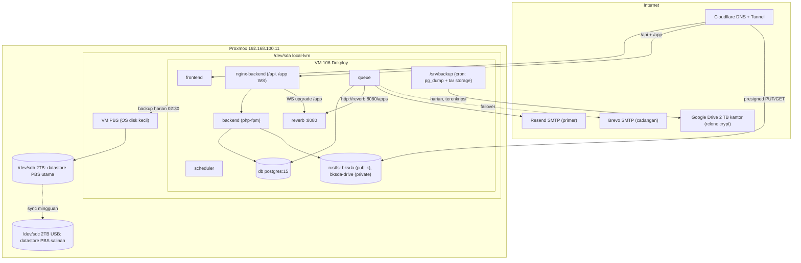
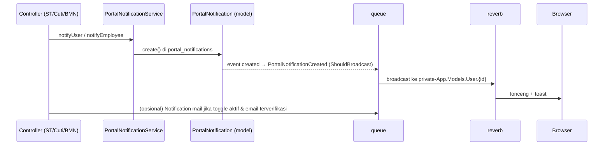
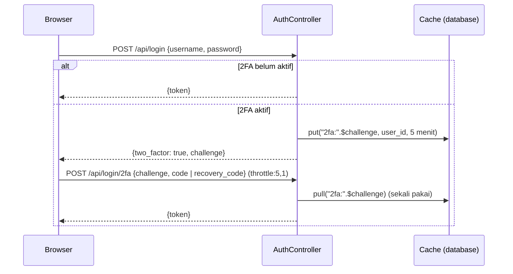
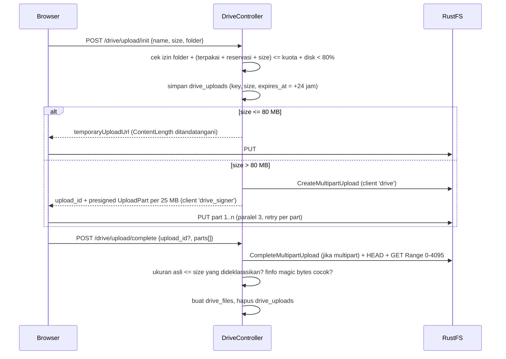

# Design v3: WebSocket Real-Time, BKSDA Drive, Email & Keamanan Akun, Backup

> **Dokumen terkait**: [requirements.md](file:///e:/bksda-superapp/docs/websocket-drive-mail-infrastructure/requirements.md) | [tasks.md](file:///e:/bksda-superapp/docs/websocket-drive-mail-infrastructure/tasks.md)
> **Prinsip**: pakai ulang yang sudah ada (`PortalNotificationService`, `User::hasPermission()`, Password Broker, failover mailer, `react-qr-code`). Dependency baru hanya `laravel/reverb`, `pragmarx/google2fa`, `laravel-echo`, `pusher-js`.

---

## 1. Arsitektur



---

## 2. Docker Compose (VM 106)

Image `backend` yang sama dipakai 4 service. **Tanpa YAML anchor** (Dokploy menulis ulang file compose). Secret memakai sintaks wajib `${VAR:?wajib diisi}` sehingga deploy langsung gagal kalau env Dokploy kosong, bukan diam-diam memakai default.

| Service | Command | Catatan |
|---|---|---|
| `backend` | `php artisan migrate --force && php-fpm` | nginx internal dihapus; `nginx-backend` sudah `fastcgi_pass backend:9000` |
| `queue` | `php artisan queue:work --tries=3 --backoff=10 --max-time=3600 --sleep=3` | `restart: always`, `stop_grace_period: 60s`, mount `backend-storage` |
| `reverb` | `php artisan reverb:start --host=0.0.0.0 --port=8080` | `restart: always` |
| `scheduler` | `php artisan schedule:work` | `restart: always`, mount `backend-storage` |
| `rustfs` | — | **Pin versi** (bukan `latest`) |

Env bersama yang wajib: `CACHE_STORE=database`, `QUEUE_CONNECTION=database`, `BROADCAST_CONNECTION=reverb`, `REVERB_HOST=reverb`, `REVERB_PORT=8080`, `REVERB_SCHEME=http`.

> [!IMPORTANT]
> `CACHE_STORE=database` wajib setelah container dipisah. Kalau tetap `file`, lock `withoutOverlapping`, rate limiter, dan challenge 2FA tidak terlihat oleh container lain.

### `deploy/nginx-backend.conf` — tambahan

Hanya `/app` yang dibuka ke publik. `/apps` (API publikasi event) tetap internal di jaringan Docker.

```nginx
location /app {
    proxy_pass http://reverb:8080;
    proxy_http_version 1.1;
    proxy_set_header Upgrade $http_upgrade;
    proxy_set_header Connection "Upgrade";
    proxy_set_header Host $host;
    proxy_read_timeout 120s;
}
```

### Frontend

- `frontend/Dockerfile`: tambah `ARG NEXT_PUBLIC_REVERB_APP_KEY`.
- Host WebSocket diturunkan dari `new URL(process.env.NEXT_PUBLIC_API_URL).hostname`, port 443, `forceTLS: true`.

---

## 3. Notifikasi Terpadu (Satu Pintu)



- **Broadcast lewat model event**, satu baris di `PortalNotification`: `protected $dispatchesEvents = ['created' => PortalNotificationCreated::class];`. Semua pemanggil `PortalNotificationService` otomatis real-time tanpa diubah satu per satu.
- **Inbox admin**: event `AdminInboxChanged($module)` di `private-admin.inbox.{module}`. Payload **minimal** (`module`, `type`, `id`). Frontend refetch lewat API yang sudah punya otorisasi, sehingga data sensitif tidak pernah ikut terkirim di WebSocket.
- **Email**: kelas Notification per event, `ShouldQueue`, `via()` hanya mengembalikan `['mail']` atau `[]`. **Tidak memakai channel `database`**, karena tabel `notifications` akan menjadi inbox kedua.

```php
public function via(User $notifiable): array
{
    return $notifiable->hasDeliverableEmail() && NotificationSetting::emailEnabled($this->eventKey)
        ? ['mail'] : [];
}
```

```php
// User.php
public function hasDeliverableEmail(): bool
{
    return $this->email_verified_at !== null && ! str_ends_with(strtolower($this->email), '.local');
}
```

---

## 4. WebSocket: Auth & Channel

`bootstrap/app.php`. Endpoint menjadi `/api/broadcasting/auth` dengan token Sanctum:

```php
->withBroadcasting(__DIR__.'/../routes/channels.php', [
    'prefix' => 'api',
    'middleware' => ['api', 'auth:sanctum'],
])
```

`routes/channels.php`. Memakai ulang `hasPermission()` (otomatis mengikuti `role`, `access_modules`, dan `permissions` granular; admin ST lewat `kepegawaian` tetap lolos):

```php
Broadcast::channel('App.Models.User.{id}', fn (User $user, int $id) => $user->id === $id);

Broadcast::channel('admin.inbox.{module}', fn (User $user, string $module) =>
    in_array($module, ['surat_tugas', 'kepegawaian', 'bmn'], true) && $user->hasPermission("{$module}.view"));
```

Frontend Echo:

```ts
new Echo({
  broadcaster: 'reverb',
  key: process.env.NEXT_PUBLIC_REVERB_APP_KEY,
  wsHost: new URL(process.env.NEXT_PUBLIC_API_URL!).hostname,
  wsPort: 443, wssPort: 443, forceTLS: true, enabledTransports: ['ws', 'wss'],
  authEndpoint: `${process.env.NEXT_PUBLIC_API_URL}/broadcasting/auth`,
  auth: { headers: { Authorization: `Bearer ${token}` } },
});
```

Fallback: kalau koneksi WS gagal, UI tidak error; data tetap tersedia lewat refresh/polling yang sudah ada.

---

## 5. Keamanan Akun

### 5.1. Kolom tambahan `users` (1 migrasi)
| Kolom | Tipe | Catatan |
|---|---|---|
| `must_change_password` | bool default false | |
| `two_factor_secret` | text null | cast `encrypted` |
| `two_factor_recovery_codes` | text null | cast `encrypted:array`, isi **hash SHA-256** dari 8 kode acak |
| `two_factor_confirmed_at` | timestamp null | |

### 5.2. Verifikasi email
1. `PUT /api/me/email` `{email, current_password}`: validasi `current_password`, `email` unik dan bukan `*.local`. Simpan, set `email_verified_at = null`, kirim notifikasi bawaan `VerifyEmail`. Jika email lama terverifikasi, kirim pemberitahuan "email akun diubah" ke email lama. `throttle:3,10`.
2. Link di email langsung ke route API bernama `verification.verify` (`GET /api/email/verify/{id}/{hash}`, middleware `signed`, **tanpa** auth). Route mencocokkan `hash_equals(sha1($user->email), $hash)`, mengisi `email_verified_at`, lalu redirect 302 ke `FRONTEND_URL/portal?email_verified=1`. Tidak perlu halaman frontend baru.
3. Admin mengubah email dari `/kepegawaian/employees` → status kembali belum terverifikasi dan link dikirim ke pegawai.

### 5.3. Lupa password
- `POST /api/forgot-password` (`throttle:3,15`): hanya memanggil `Password::sendResetLink()` jika user `hasDeliverableEmail()`. Respons **selalu sama**.
- `AppServiceProvider::boot()`:
  ```php
  ResetPassword::createUrlUsing(fn ($user, string $token) =>
      config('app.frontend_url').'/reset-password?token='.$token.'&email='.urlencode($user->email));
  ```
  Tanpa ini Laravel mencari `route('password.reset')` yang tidak ada dan mengembalikan error 500.
- `POST /api/reset-password` → `Password::reset()`. Callback: set password, `must_change_password = false`, `tokens()->delete()`, kirim *security alert*.

### 5.4. Paksa ganti password & wajib 2FA admin
Middleware `EnsureAccountSecure` di grup `auth:sanctum`. Return `423` dengan `{reason: 'must_change_password' | 'must_setup_2fa'}` kecuali untuk route allowlist (`/me`, `/me/change-password`, `/me/2fa/*`, `/logout`). Frontend mengarahkan ke halaman yang sesuai.

```php
$reason = match (true) {
    $user->must_change_password => 'must_change_password',
    in_array($user->role, ['admin', 'super_admin'], true) && ! $user->two_factor_confirmed_at => 'must_setup_2fa',
    default => null,
};
```

### 5.5. Login dua langkah (TOTP)

- Verifikasi TOTP: `pragmarx/google2fa` dengan window ±1 (30 detik). Kode yang sudah dipakai disimpan di cache 90 detik untuk mencegah *replay*.
- Recovery code: cocokkan `hash('sha256', $input)`; jika cocok, hapus dari array.
- Setup: `POST /me/2fa/enable` mengembalikan URI `otpauth://` (QR dirender oleh `react-qr-code`) → `POST /me/2fa/confirm {code}` mengisi `two_factor_confirmed_at` dan menampilkan 8 recovery code **sekali**.
- Super admin bisa `DELETE /api/employees/{id}/2fa` untuk pegawai yang kehilangan HP. Aksi ini dicatat di audit log, dan admin yang direset wajib setup ulang saat login.

### 5.6. Reset oleh admin (`EmployeeController::resetPassword`)
- Mode A (default): generate `Str::password(12)`, kembalikan **sekali** di respons untuk ditampilkan ke admin, `must_change_password = true`, `tokens()->delete()`.
- Mode B (jika email terverifikasi): `Password::sendResetLink()`. Password tidak pernah dikirim lewat email.

---

## 6. Email

### 6.1. `config/mail.php` (tanpa dependency baru)
```php
'default' => env('MAIL_MAILER', 'failover'),
'mailers' => [
    'resend_smtp' => ['transport' => 'smtp', 'host' => 'smtp.resend.com', 'port' => 587,
        'username' => 'resend', 'password' => env('RESEND_API_KEY'), 'timeout' => 10],
    'brevo_smtp'  => ['transport' => 'smtp', 'host' => 'smtp-relay.brevo.com', 'port' => 587,
        'username' => env('BREVO_SMTP_LOGIN'), 'password' => env('BREVO_SMTP_KEY'), 'timeout' => 10],
    'failover'    => ['transport' => 'failover', 'mailers' => ['resend_smtp', 'brevo_smtp', 'log']],
],
'from' => ['address' => env('MAIL_FROM_ADDRESS', 'noreply@notif.bksdakaltim.web.id'), 'name' => 'BKSDA Kaltim'],
```
Saat kuota Resend habis, SMTP Resend menolak, `TransportException` dilempar, dan Laravel otomatis mencoba Brevo. Penerima tetap melihat pengirim `noreply@notif.<domain>`.

### 6.2. DNS `notif.<domain>`
| Record | Nilai |
|---|---|
| SPF | `v=spf1 include:amazonses.com include:spf.brevo.com ~all` (sesuaikan dengan nilai yang diberikan dashboard Resend & Brevo) |
| DKIM | CNAME/TXT dari Resend **dan** Brevo |
| DMARC | `_dmarc.notif` → `v=DMARC1; p=none; rua=mailto:<email admin>`; naik ke `p=quarantine` setelah 2 minggu bersih |
| Inbound | Cloudflare Email Routing untuk alamat balasan/verifikasi |

### 6.3. Webhook bounce Resend
`POST /api/webhooks/resend`, di luar `auth:sanctum`, `throttle:60,1`. **Verifikasi Svix wajib**: HMAC-SHA256 dari `"{svix-id}.{svix-timestamp}.{body}"` dengan secret `whsec_…` (base64-decode), dibandingkan `hash_equals` dengan header `svix-signature`, dan timestamp tidak lebih dari 5 menit. Gagal → 401. Event `email.bounced` (hard) / `email.complained` → `email_verified_at = null` + notifikasi Portal.

### 6.4. Log
Listener `MessageSent` dan `MessageFailed` → `email_logs` (`to`, `subject`, `mailer`, `status`, `error`, `created_at`). Halaman Pengaturan menampilkan hitungan hari ini per mailer, toggle per event, master switch, dan tombol test.

---

## 7. BKSDA Drive

### 7.1. Dua disk S3 (masalah host di presigned URL)
`drive` memakai endpoint internal `http://rustfs:9000` untuk operasi server. `drive_signer` memakai `STORAGE_PUBLIC_ENDPOINT` (`https://storage.<domain>`) **hanya untuk menandatangani URL**. Penandatanganan SigV4 adalah perhitungan lokal tanpa panggilan jaringan, jadi URL cocok dengan host yang dipakai browser. Hostname storage di Cloudflare Tunnel **tidak** boleh menimpa `httpHostHeader`.

CORS bucket `bksda-drive`: origin `FRONTEND_URL`, method `PUT, GET, HEAD`, expose `ETag`. Kalau versi RustFS yang di-pin tidak mendukung CORS per bucket, pakai Cloudflare Transform Rule. Ini dibuktikan di **spike Fase 2.0** sebelum UI dibangun.

### 7.2. Upload + reservasi kuota

- Presign `UploadPart` tidak tersedia di facade `Storage`, jadi pakai `$disk->getClient()->createPresignedRequest($client->getCommand('UploadPart', [...]), '+60 minutes')`. AWS SDK sudah terpasang lewat Flysystem.
- **Cleanup terjadwal (per jam)**: `drive_uploads` yang kedaluwarsa → `AbortMultipartUpload` / `DeleteObject` lalu hapus barisnya. Karena setiap upload pasti punya baris, objek yatim tidak mungkin tertinggal. Item di Sampah yang lebih dari 30 hari di-purge.
- Validasi gagal → objek dihapus dan reservasi dilepas.

### 7.3. Preview aman
URL GET di-sign 15 menit dengan `ResponseContentDisposition`: `inline` hanya untuk MIME hasil `finfo` ∈ {pdf, jpeg, png, webp, mp4}; selain itu `attachment; filename="…"` + `ResponseContentType=application/octet-stream`.

### 7.4. Drive Bersama (D7)
Tabel `drive_units(code, name, auto)` di-seed 9 unit. Tabel `drive_unit_members(unit_code, user_id, role: viewer|editor|manager)`.

```php
public function unitRole(User $user, string $unit): ?string
{
    if ($user->role === 'super_admin') return 'manager';

    $manual = DriveUnitMember::where(['unit_code' => $unit, 'user_id' => $user->id])->value('role');
    if ($manual) return $manual;

    $employee = Employee::where('nip', $user->username)->first(); // pola yang sama dengan AuthController (User belum punya relasi employee)
    if (! $employee) return null;

    $auto = match ($unit) {
        'skw-1-berau'      => $employee->seksi_wilayah === 'I',
        'skw-2-tenggarong' => $employee->seksi_wilayah === 'II',
        'skw-3-balikpapan' => $employee->seksi_wilayah === 'III',
        'kantor-balai'     => $employee->seksi_wilayah === null,
        default            => false, // subbag-tu, seksi-p3, seksi-pp, keuangan, tim-folu: manual
    };

    return $auto ? 'editor' : null;
}
```
Hanya `manager` unit atau super_admin yang bisa menambah/menghapus anggota manual. Pegawai yang pindah satuan kerja otomatis pindah akses auto-nya.

### 7.5. Auto-archive
Job `ArchiveOfficialDocument($sourceModule, $sourceId, $sourceDisk, $sourcePath)`: stream copy `Storage::disk($sourceDisk)->readStream()` → `Storage::disk('drive')->writeStream('system_archive/{tahun}/{modul}/…')`, lalu `drive_files::firstOrCreate(['source_module', 'source_id'])`. Retry 3x. Gagal masuk `failed_jobs` + alert. Alur persetujuan tidak pernah terblokir.

> [!WARNING]
> Auto-archive tidak menutup risiko bucket publik `bksda`. Task Fase 0 mengaudit policy bucket tersebut: anonymous `GetObject` boleh (dipakai frontend), tapi `ListBucket` harus ditolak agar dokumen tidak bisa dienumerasi.

---

## 8. Backup & Restore

### 8.1. Proxmox Backup Server (D8)
- PBS 3.x/4.x **sebagai VM baru** di `pve` (2 vCPU, 4 GB RAM, OS disk 32 GB di `local-lvm`). `/dev/sdb` di-passthrough (`qm set <id> -scsi1 /dev/disk/by-id/<sdb>`) dan dijadikan datastore `main`. `/dev/sdc` di-passthrough sebagai datastore `copy`.
  - Kenapa VM dan bukan dipasang di host: host masih PVE 7.4 (Debian 11). PBS untuk Debian 11 (2.x) juga sudah EOL, sedangkan PBS di VM bisa memakai versi yang masih didukung.
  - Kalau `/dev/sda` rusak, VM PBS ikut hilang, tapi datastore di `/dev/sdb` bersifat mandiri. Instal PBS baru, tambahkan datastore dengan path yang sama, lalu restore.
- Storage `pbs-main` ditambahkan di PVE. Job backup VM 106 harian 02:30 WITA, mode snapshot, retensi `keep-daily=7, keep-weekly=4, keep-monthly=6`. Dedup dan inkremental membuat 17 titik restore muat walaupun Drive tumbuh ratusan GB.
- `qemu-guest-agent` diaktifkan di VM 106 agar snapshot melakukan fs-freeze (konsisten untuk Postgres).
- Sync job mingguan `main` → `copy`. Prune + garbage collection + **verify job** mingguan.

### 8.2. Backup logis harian di VM 106 (cron host VM, 01:00 WITA)
```bash
#!/bin/sh
set -eu
D=$(date +%F); B=/srv/backup; mkdir -p $B/db $B/storage
DB=$(docker ps -qf label=com.docker.compose.service=db | head -1)
docker exec "$DB" pg_dump -U "$DB_USER" -Fc bksda_superapp > $B/db/bksda-$D.dump
docker run --rm -v <volume backend-storage>:/data:ro -v $B/storage:/out alpine tar czf /out/storage-$D.tgz -C /data .
find $B -type f -mtime +14 -delete
# offsite terenkripsi ke Google Drive 2 TB kantor: dump DB + tar storage, lalu seluruh bucket
RC="docker run --rm --network <jaringan compose> -v /etc/rclone:/config/rclone -v $B:/backup:ro rclone/rclone"
$RC copy /backup gdrive-crypt:backup
$RC delete gdrive-crypt:backup --min-age 90d
for BUCKET in bksda bksda-drive; do
  $RC sync rustfs:$BUCKET gdrive-crypt:buckets/$BUCKET --backup-dir gdrive-crypt:deleted/$D/$BUCKET
done
$RC delete gdrive-crypt:deleted --min-age 30d --rmdirs
curl -fsS "<heartbeat-url>" || true
```
`/srv/backup` berada di disk VM 106, jadi ikut ter-backup PBS. VM tidak perlu akses langsung ke `/dev/sdb`.

### 8.3. Offsite: Google Drive 2 TB Akun Kantor (D9)
Karena kantor memiliki akun Google Workspace/Drive dengan kuota **2 TB**, ini dimanfaatkan maksimal:
1. **Ruang Lingkup Backup**: Tidak hanya DB dump dan Arsip Resmi, tapi **seluruh isi RustFS** (`bksda` dan `bksda-drive`, termasuk Drive Saya) bisa disinkronkan secara offsite.
2. **Keamanan (`rclone crypt`)**: Seluruh file dan nama path dienkripsi sebelum meninggalkan server menggunakan standar enkripsi AES. Google sama sekali tidak bisa membaca isi dokumen kantor.
3. **OAuth `drive.file`**: Menggunakan Client ID tersendiri dengan izin terbatas hanya membaca/mengubah file yang dibuat rclone itu sendiri.
4. **Proteksi Human Error & Ransomware (`--backup-dir`)**: File yang terhapus/berubah di lokal tidak langsung dihapus di Google Drive, melainkan dipindahkan ke folder `deleted/{tanggal}` dan baru dibersihkan setelah 30 hari. Password crypt disimpan di luar server.

### 8.4. Uji restore (wajib, tercatat)
| Frekuensi | Uji |
|---|---|
| Bulanan | `pg_restore` dump terbaru ke DB `bksda_restore_verify`, cocokkan jumlah baris tabel inti |
| Bulanan | Unduh 1 berkas dari offsite, dekripsi, buka |
| Triwulanan | Restore VM 106 dari PBS ke VM ID baru (jaringan terisolasi), login berhasil |

---

## 9. Rotasi Secret (urutan aman)
1. **DB**: `ALTER USER <user> WITH PASSWORD '<baru>'` di container `db` → ubah `DB_PASSWORD` di Dokploy → redeploy. (`POSTGRES_PASSWORD` hanya dibaca saat volume pertama kali dibuat; mengganti env saja akan memutus koneksi.)
2. **APP_KEY**: set `APP_PREVIOUS_KEYS=<lama>` dan `APP_KEY=<baru>`. Lakukan **sebelum** Fase 1C agar secret 2FA langsung terenkripsi dengan key baru. Token Sanctum tetap valid (hash SHA-256, tidak memakai APP_KEY).
3. **RustFS**: buat access key baru → ganti env → hapus key lama.
4. Hapus semua default secret dari compose (`${VAR:?wajib}`). Secret lama sudah ada di git history, jadi diperlakukan **sudah bocor**. Rewrite history opsional.

---

## 10. Monitoring
| Sinyal | Mekanisme | Alert |
|---|---|---|
| Queue hidup | Scheduler dispatch `QueueHeartbeat` tiap 5 menit (set cache `queue:heartbeat`); scheduler cek > 15 menit basi | Portal + email super_admin (dedup 1x/jam) |
| Reverb hidup | Scheduler `fsockopen('reverb', 8080)` tiap 5 menit | sama |
| Job gagal | Hitung `failed_jobs` baru tiap 15 menit | sama |
| Disk | `disk_free_space` volume RustFS > 80% | sama |
| Backup | Cron 8.2 ping heartbeat; job PBS kirim notifikasi email PVE/PBS | email |
| Container | `healthcheck` compose (informasi status di Dokploy) | — |

---

## 11. Runbook Pindah Domain `.web.id` → `.id`
1. Tambah domain `notif.bksdakaltim.id` di Resend (paket gratis hanya 1 domain: tambah yang baru setelah yang lama dihapus) dan Brevo; pasang SPF/DKIM/DMARC.
2. Tambah hostname `bksdakaltim.id`, `api.`, `storage.` di Cloudflare Tunnel.
3. Ubah env: `APP_URL`, `FRONTEND_URL`, `STORAGE_PUBLIC_ENDPOINT`, `MAIL_FROM_ADDRESS`, `NEXT_PUBLIC_API_URL`, `NEXT_PUBLIC_STORAGE_URL`, CORS API (`config/cors.php`) dan CORS bucket.
4. **Rebuild frontend**, karena `NEXT_PUBLIC_*` dibekukan saat build.
5. Redirect 301 `*.bksdakaltim.web.id` → `*.bksdakaltim.id` minimal 6 bulan, agar link lama di email dan share publik tetap hidup.
6. Data DB tidak berubah (path relatif).
